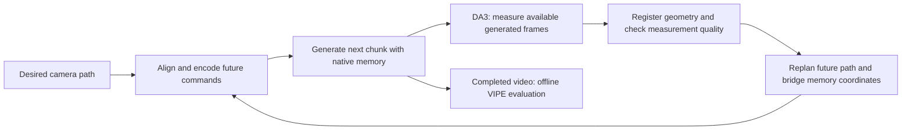

# Closed-loop camera correction

Model-aware camera alignment and causal command correction for video generators.
The portable controller measures a generated endpoint and replans **future camera commands** in the model's native camera representation. A separate opt-in runtime can rebuild supported model memories under measured poses. Neither path repairs already-generated images or trains a generator.

For paper writing, start with [the method reference](docs/paper_method_reference.md): equations, assumptions, implemented versus proposed components, per-model memory consumers, evaluation, and claim limits. See [measured-memory integration](docs/measured_memory.md) and the [dated development evidence](docs/paper_evidence_20261101.json) for the new seven-model path. Results are mixed; this is not a claim of universal tracking improvement.

The primary candidate is now frozen as [measured-memory v1](docs/method_v1.md):
memory reconstruction with the native baseline target policy, without adaptive
gains or residual command correction. Its expanded development protocol fixes
two common scenes, two seeds, and five qualified model paths before scoring.
WorldWarp and Astronex remain qualification pending; Matrix-Game stays included
despite its negative initial result.

## Quick start

```bash
git clone https://github.com/alicaank/closeloopcorrection.git
cd closeloopcorrection
python -m pip install -e .
python examples/synthetic_loop.py
python -m unittest discover -s tests -v
camera-loop models
```

The package requires Python 3.10+, NumPy, SciPy and Pillow; it does not load Torch or occupy a GPU. The demo is a simulated under-executing camera, **not a measured model result**.

## Readiness

This is a research integration toolkit. Native environments and checkpoints still require setup, and fresh-machine GPU execution has not been qualified. CPU source/package checks are not an end-to-end installation guarantee.

For another dataset or more scenes, use the [dataset import, validation and serial experiment guide](docs/datasets.md). The importer requires registered poses/depth/intrinsics; it does not estimate them from raw video.

## How closed-loop correction works

The input is a desired camera trajectory, a conditioning image, and the generator's normal text/image/memory inputs. A camera command is not necessarily the camera motion visible in the resulting video: a generator may under-execute translation, drift in rotation, or accumulate error across chunks. The controller observes that discrepancy at a generation boundary and changes the next chunk's camera conditioning. It needs no generator weight update.



### 1. Establish one geometric reference

The portable controller uses anchor-relative, OpenCV **camera-to-world** matrices. A pose `T = [R, t; 0, 1]` maps camera coordinates into this fixed reference. The adapter converts the dataset's cameras, depth and intrinsics into that convention, then converts outgoing commands into the generator's own convention.

For depth-calibrated models, the native translation factor is `k = median(native_depth / reference_depth)` over valid corresponding anchor pixels. Depths must describe the same surface, pixel rays and depth convention. Resizing or cropping an image requires the matching intrinsics and depth transformation. Some adapters instead need an explicit metric or normalization contract. The checkpoint, anchor and normalization context bind the saved calibration; an unexplained factor is an error, not an invitation to tune it against the desired motion.

This native-model calibration differs from observer registration. A fresh reconstruction can have its own arbitrary scale and coordinate frame. Its poses must be registered back into the fixed reference for each observation. Reusing a previous raw observer scale can create apparent camera jumps even when the rendered motion is smooth.

### 2. Generate, then measure only available frames

Run the model for one native generation chunk. In the local experiments, DA3 observes generated images available up to that boundary. It must not receive future images or commanded cameras as pose labels. The adapter is responsible for registering its reconstruction, reporting measurement quality and returning the pose of the **actual last generated frame**.

The portable `Measurement` object contains that endpoint pose, its frame ID and a quality record. For correction, `CorrectionSession` rejects stale/future measurements, invalid rigid transforms and failed quality gates. Sham still validates frame IDs and causality, but bypasses pose/quality rejection because it does not use the measured pose; the rejected quality report remains in its event log. A host integrating the core API supplies its own observer; DA3 is provided through the bundled research adapters rather than loaded by the NumPy controller.

### 3. Rejoin the desired trajectory smoothly

Let `P_t` be the original planned pose at the boundary, `M_t` the measured pose, and `P_(f_i)` the planned future poses at output-frame IDs `f_i`. With full correction gains, define:

```text
translation residual: delta_t = translation(M_t) - translation(P_t)
rotation residual:    delta_R = rotation(M_t) @ rotation(P_t).T
elapsed fraction:     a_i = (f_i - t) / (f_last - t)
fade:                 w_i = 1 - a_i

translation(D_i) = translation(P_(f_i)) + w_i * delta_t
rotation(D_i)    = Slerp(delta_R, identity, a_i) @ rotation(P_(f_i))
```

`D_i` is the desired future path after replanning. It starts near the observed boundary and gradually rejoins the original plan; the final pose is the original chunk target. Separate translation and rotation gains in `[0,1]` can attenuate the measured residual before replanning. This is a boundary rejoin rule, not a guarantee of constant velocity or acceleration: noisy measurements, abrupt desired paths and imperfect model execution still need to be inspected.

The fade follows elapsed output frames, including nonuniform latent-to-image sampling. Uniformly spaced schedules retain `a_i = i/N`. Frame IDs assume a fixed output frame rate; variable-rate time in seconds is not currently a separate API.

### 4. Respect the model's memory coordinates

The image at the boundary was generated under some previous command `U_t`, which can differ from both `P_t` and `M_t` after earlier corrections. If the model's memory labels that image with its **commanded** pose, future commands must be expressed in that same memory frame. At full gains the portable controller uses:

```text
B   = U_t @ inverse(M_t)
C_i = B @ D_i
```

This makes the relative motion from the stored boundary label agree with the desired motion from the measured boundary: `inverse(U_t) @ C_i = inverse(M_t) @ D_i`. Simply supplying `D_i` to commanded-pose memory would mix coordinate frames. With reduced gains the implementation uses the gain-adjusted endpoint in this bridge too, so zero gain does not leave a hidden full-strength compensation.

If memory has actually been relabelled with registered **measured** poses, the desired path can instead be supplied directly. Setting `history_labels="measured"` does not rewrite a model's memory automatically: the host must maintain that invariant. Measured-memory writes, including the explicit VMem `replan_measured` ablation and the new [seven-model memory runtime](docs/measured_memory.md), are separate experiments. The default generic hook writes only future conditioning and retains native model memory.

The adapter finally applies native units/axes and c2w/w2c conversion. For relative-chain conditioning, it composes relative transforms after converting both endpoints into the native camera basis. Ray or Plücker encodings remain the host model's responsibility.

### 5. Repeat and evaluate independently

After generating the next chunk, measure again and repeat. Past frames are immutable; correction cannot fix a frame already emitted. If a generator systematically under-executes, the changed conditioning may request a larger relative movement toward the target, but success remains an empirical property of the model and scene.

Use matched **baseline**, **sham**, and **correction** runs where the adapter supports them. Baseline uses the planned commands. Sham exercises the measurement path while bypassing command correction; the portable controller's sham preserves those planned commands exactly. Compare identical scenes, seeds, lengths and sampling schedules, and report observation overhead separately. Historical Memorizon/WorldPlay adapters do not yet provide verified native/sham controls.

The equations above describe `CorrectionSession`/`AlignedLoop`. Bundled research launchers retain model-specific controller implementations, chunk schedules and guards; they are not all equivalent implementations of this portable controller. See [integration details](docs/integration.md) before interpreting an adapter result as a test of these exact equations.

See [the shared-controller audit and proposed design](docs/controller_audit.md) for the reproduced bugs, patch coverage, and the remaining work on observation reliability, feasible motion and memory consistency.

The experimental [adaptive-controller pilot](docs/adaptive_controller.md) now implements shared evidence gating, bounded recovery across chunks and conservative directional response fitting. It has isolated LingBot/SANA adapters and a frozen B/C queue; this is a separate experimental API from `CorrectionSession`, with GPU efficacy still to be established.

## Evaluate with VIPE

**VIPE is the default camera evaluator for the bundled long, pair and 80-frame scoring entrypoints.** DA3 remains the correction observer. VIPE processes every consecutive frame of the completed video with fixed, model-preprocessed intrinsics; it is an offline evaluator and may use later frames. Its trajectory must never feed back into a causal generation run.

For evaluation, the initial VIPE pose defines the rigid anchor and shared anchor depth defines scale:

```text
s = median(reference_anchor_depth / VIPE_optimized_anchor_depth)
T_i = inverse(VIPE_pose_0) @ VIPE_pose_i
translation(T_i) *= s
```

The depths are compared at registered pixels. The desired trajectory is not supplied to SLAM or used to fit scale, rotation or translation. Position error is Euclidean distance in the stored anchor-depth units; rotation error is the SO(3) geodesic angle in degrees. Report camera mean and endpoint errors alongside DINO similarity and LPIPS against the recording. Those appearance metrics measure agreement with the recording, not all aspects of visual quality or temporal consistency.

The bundled VIPE pair/long scorer reports absolute measured and target translation path lengths. If target travel is at most `1e-8` anchor units, its translation path ratio is `null` with an explicit reason; a rotation-only target cannot define that ratio. This is a numerical validity rule, not a calibrated motion-noise threshold. Historical scores are not rewritten.

Packaged scale registration also rejects the pinned VIPE optimizer's saturated inverse-depth values. The protocol `vipe_dense_anchor_depth_no_saturation_v2` distinguishes this from the earlier permissive fit; it does not yet include the experimental native-map-mask diagnostic used in later local audits.

VIPE writes dense trajectories, registration diagnostics and evaluator provenance. Historical VGGT reports stay historical; compare baseline/correction under the same evaluator and protocol, and re-score both arms before making a new claim. Some stored reference trajectories are themselves VIPE-derived, so using a different correction observer does **not** make those references independent ground truth.

See [VIPE installation, evaluation commands and output format](docs/evaluation.md). The release includes CPU registration checks and a local VIPE configuration/import dry run. The separate local measured-memory queue now has short VIPE comparisons recorded in the [development evidence snapshot](docs/paper_evidence_20261101.json); these do not qualify fresh-machine GPU execution of every packaged scoring route.

## Automatic alignment

A model declares its camera direction, camera axes, native unit contract and conditioning layout. The alignment layer then:

1. Fits native/reference depth scale on registered anchor pixels, or reads the model's explicit metric/normalization conversion.
2. Checks shared depth coverage and ratio dispersion; rejects unsupported or missing unit contracts.
3. Stores the conversion against the checkpoint, anchor and normalization context; matched runs reuse it and inconsistent calibrations fail.
4. Converts commands and measured geometry consistently, including OpenCV/OpenGL and c2w/w2c conventions.
5. Rejects stale measurements, invalid poses and writes to already-generated frames.

A response ratio such as 1.05 is **not** a scale-calibration target. Calibrate geometry before interpreting under-execution. An observer's raw reconstruction gauge may change at each call: align each observation to the fixed reference independently. Do not freeze a raw observer scale or fit scale to the desired trajectory.

```bash
# NPZ arrays must already describe the same anchor pixels and depth convention.
camera-loop align --model lyra --depths registered_anchor.npz \
  --checkpoint checkpoint-sha --anchor-id scene-01 \
  --out outputs/scene-01/alignment.json
```

`registered_anchor.npz` contains `reference_depth`, `native_depth`, and optional `mask`. Other strategies accept `--metric-scale` or `--native-scale` together with `--evidence`. Unknown factors are never silently replaced by one in the core API.

## Integrate another generator

Use `ModelHooks` and `AlignedLoop`: supply native calibration, the actual previous absolute camera command, and a callback that updates future conditioning. The host model keeps its own memory, latent timeline, ray/Plücker encoding and generation loop.

See [the integration contract and example](docs/integration.md). This API supports generators that expose camera conditioning and causal generation boundaries. It cannot add camera control to a model that has no such interface.

## Run the existing model adapters

The source bundle includes local adapters for **Lyra-2, Spatia, Matrix-Game 3.5, VMem, Astronex, LingBot v2, DreamX, WorldWarp, SANA-WM, Memorizon and WorldPlay**. Their checkpoint requirements, scale contracts and validation limits differ; see [the model table](docs/models.md).

The portable API and the bundled research launchers are separate integration paths. The latter preserve the existing model-specific controller code; they are not all migrated to `AlignedLoop`. In particular, historical native-scale assumptions are not made validated merely by packaging them here.

```bash
cp config.example.json config.local.json
# Edit external interpreter/cache/weight path mappings for your machine.
camera-loop prepare --workspace /data/camera-work --config config.local.json --clone
camera-loop doctor --workspace /data/camera-work --config config.local.json

# Prints the exact command without starting GPU work.
camera-loop run --workspace /data/camera-work --model spatia \
  --python /opt/envs/spatia/bin/python --batch /data/eval-batch \
  --scene scene-01 --out /data/results/spatia-scene-01 --arm correction
# Add --execute after installing the native model/observer environments and assets.
```

`prepare` requires an empty destination, verifies source hashes, checks out pinned upstream revisions when `--clone` is set, applies the included patches, and relocates adapter paths. It does not install CUDA environments or download checkpoints/datasets. Each model runs in its own native environment. Follow [team setup](docs/setup.md) for assets, subprocess interpreters and batch format.

## Our RTX 5090 setup

See [running Spatia and Lyra-2 on 32 GB](docs/rtx-5090.md) for the inspected environments, CPU offload strategy, caption-cache preparation, pilot/long-run commands, observed timings and remaining memory limits.

## Validation and scope

The current 107-test CPU suite passes from source; the earlier 67-test revision also passed from an installed wheel. It covers geometry, controller semantics, calibration binding, quality/causality rejection, all 11 original launcher paths, the seven explicit memory launchers, and compilation after relocation. New regressions cover chunk-response timing, rejection transitions, bootstrap bounds, exact-input evaluation reuse and lossless RGB retention. GPU end-to-end portability has not yet been established. Historical v3 guard qualification remains separate from the locally GPU-tested memory runtime; WorldWarp's guarded continuation is limited to two chunks.

See [validation protocol](docs/validation.md). Source pins and available upstream license notices are retained under `src/camera_loop/bundled/`. No weights, datasets, generated videos, credentials or training checkpoints are included. See [NOTICE](NOTICE).

Runtime unit conversion for VMem, WorldWarp, Memorizon, Astronex, and WorldPlay is documented in [online units](docs/online_units.md). Astronex/WorldPlay fail explicitly without an audited runtime native-geometry provider; no provider or physical calibration is claimed for their pose-only encoders.

See [the November 2 audit corrections](docs/audit_fixes_20261102.md) for the
implemented fixes, corrected historical accounting and frozen replacement
experiments. GPU efficacy from those replacement experiments is still pending.
