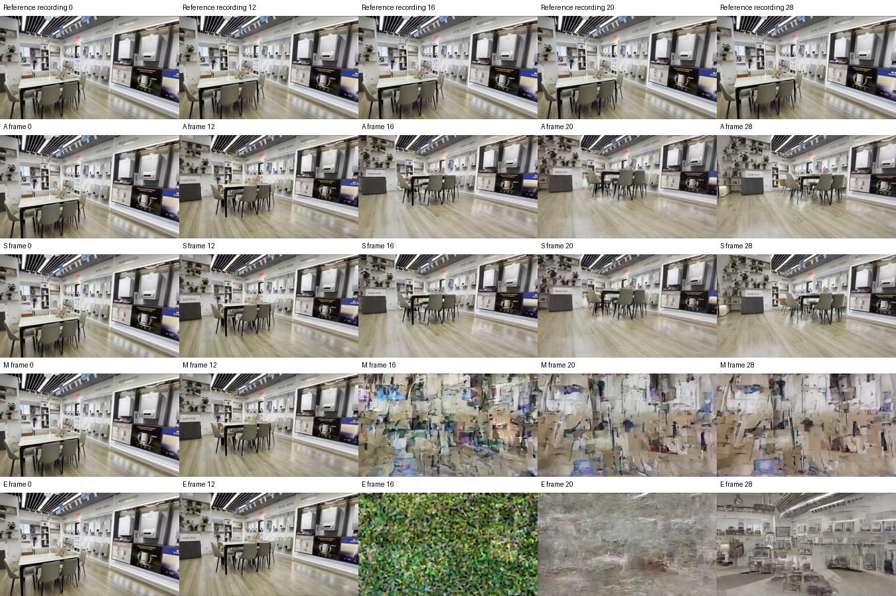
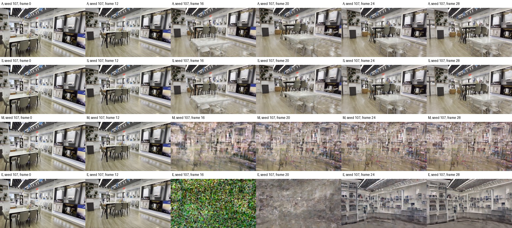
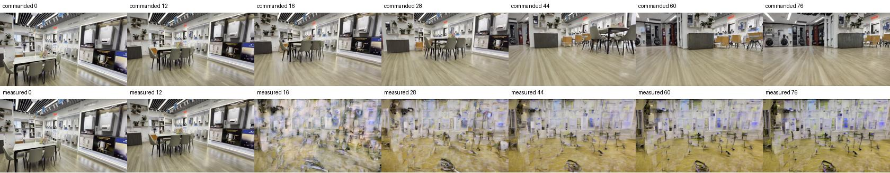

# Control mechanism audit: visual collapse, input range, and reachability

Executed 2026-11-02 UTC; the artifact directory retains its `20261103` label.

Follow-up: the [cross-model six-arm study](memory_components_20261102.md)
separates rotation and translation, extends fresh generation to DreamX and
SANA, and reviews the other memory writers. This page preserves the earlier
four-arm experiment and its then-unresolved component attribution.

The new matched LingBot experiment fails visually in both seeds. Measured-memory
reconstruction changes the continuation while preserving every future camera
tensor, but the changed continuation collapses. Its lower pose-estimation error
is **not evidence of successful camera correction**. The earlier 77-frame,
four-write LingBot result has the same failure and must be retained as a policy
failure, not counted as a tracking win.

This is a development diagnosis on one selected scene, not a generalization
experiment. It changes the interpretation of the frozen v1 results; it does not
silently change their algorithm, thresholds, scores, or source snapshots.
[Machine-readable evidence](control_mechanism_evidence_20261103.json) includes
raw metrics, input hashes, visual-review labels, and limitations.

## Matched intervention test

Scene `02267acf`, seeds 7 and 107, 29 RGB frames, intervention after frame 12.
Every arm decodes the same prefix. One DA3 measurement per seed is reused only
after exact RGB, intrinsics, and anchor-depth identity checks. No future images
enter the write. Python, NumPy, and Torch RNG states are preserved.

| Arm | History/cache conditioning | Future camera conditioning |
|---|---|---|
| A | Native commanded labels | Original native inputs |
| S | Re-encode identical commanded labels | Original native inputs |
| M | Measured labels in the native clean-cache forward | Original native inputs |
| E | Commanded labels | Bridge matching M's implied cumulative camera path |

Both seeds passed exact first-13-frame equality, full A/S RGB equality, and
A/S/M future-camera tensor equality. E preserves first-chunk conditioning and
changes the subsequent camera tensor as intended. All observations passed the
existing staging gate. These are attribution checks, not efficacy checks.

E uses `F_bridge = M_last inverse(C_last) F_original` because LingBot consumes
framewise camera increments. It matches the cumulative path implied by measured
history followed by the original relative increments. It does not reproduce M's
hidden KV state and is not the generic desired-pose-to-stored-boundary bridge.
This diagnostic does not clip the bridge jump or propose it for deployment.

Post-intervention camera errors cover frames 13–28. Translation is in fixed
anchor-depth units, not verified metric metres. Every arm passes VIPE's initial
anchor registration.

| Seed | Arm | Mean position error | Mean rotation error (degrees) | Sampled continuation |
|---|---|---:|---:|---|
| 7 | A / S | 0.31740 | 2.379 | Recognizable scene; excessive motion |
| 7 | M | 0.08877 | 3.256 | Severe scene corruption |
| 7 | E | 0.19194 | 9.215 | Corrupted transition; distorted later recovery |
| 107 | A / S | 0.26042 | 2.568 | Recognizable scene, with some ghosting |
| 107 | M | 0.09444 | 2.432 | Severe scene corruption |
| 107 | E | 0.12716 | 5.667 | Corrupted transition; distorted later recovery |

The nominal M position reductions are 72.0% and 63.7%. Neither is a successful
tracking outcome. The visual classifications are retrospective inspection of
sampled frames, not a prespecified automatic collapse detector. Failed arms
remain in policy totals; discarding them would bias the evaluation.

The earlier 77-frame pair reported a 74.24% mean position reduction and four
accepted writes. Its measured continuation is also badly corrupted after the
first write. Prefix equality and valid anchor registration did not prevent this.
The original score remains unchanged, with a separate visual-review sidecar.

## Input-range finding and its limits

The native LingBot encoder divides translation increments by the maximum
translation norm of its planned camera sequence. Here that normalizer is
`0.0007368588703684509` reference units. The native plan's maximum step becomes
1. The first three nonzero commanded steps are 0.545, 0.741, and 0.593.
The memory writer divides measured increments by the **same** normalizer:

| Seed | Measured step 1 | Measured step 2 | Measured step 3 |
|---|---:|---:|---:|
| 7 | 70.107 | 105.615 | 105.331 |
| 107 | 70.011 | 81.160 | 75.443 |

Thus mathematically consistent conversion sends measured history far outside
this run's native command envelope. The target prefix moves very little;
normalization nevertheless supplies ordinary-sized native commands. Generated
motion is much larger than the target, and relabeling it in the original command
gauge produces extreme memory conditioning. E similarly makes a large bridge.

This is a plausible failure mechanism, not an isolated causal proof that
translation amplitude alone causes collapse. Rotation changes, history/image
compatibility, and cache semantics were not independently varied. Nor does the
plan envelope establish the model's training distribution or a universal safe
threshold. The experiment establishes that the **complete measured rewrite**
causes a failed continuation under the matched conditions.

An observer pose can be geometrically valid while its encoding is unsuitable
for the model. Per-plan normalization is an operational camera convention; it
does not by itself establish physical camera semantics for measured labels.
Independently renormalizing measured history would change its gauge relative to
future commands and retained state. Clipping labels would no longer write the
measured geometry. Neither is a justified silent fix, and fitting execution gain
does not establish a physical unit conversion.

## What the zigzag counts actually measure

Source inspection corrects the earlier VMem wording: the saved issued-command
array is **not overwritten** with later measurements. Native `pipe.c2ws` memory
labels change; each subsequent command block is rebased to the actual memory
boundary. Connecting the old requested endpoint directly to the next block
therefore adds differences that are not its issued relative camera increments.

| Model / scene | Saved absolute-path reversal count | Issued relative-increment reversal count |
|---|---:|---:|
| VMem 989b9344 | 9 | 0 |
| VMem d3f042a2 | 13 | 1 |
| VMem 74310829 | 15 | 1 |

The increment diagnostic transports consecutive velocities into a common local
basis. Native boundary-to-future transforms reconstruct the controller receipts
to numerical precision. Full historical VMem context selection and rendered
memory inputs were not logged, so these checks do not certify all final model
conditioning. DreamX's saved quantized native matrices, in contrast, reconstruct
exactly in both audited scenes; their bounded command reversal counts are zero.
Its tracking still worsens, so removing command reversals is insufficient.

Spatia B and C have identical RGB and issued commands. Two additional independent
VIPE evaluations of the same 481-frame sequence show path lengths 1.236 and
1.262, versus the original B/C estimates 1.315 and 1.608. Detailed reversal counts
are observer-sensitive. Nevertheless, all four estimates show backward projected
progress from frames 336→344 (−0.031 to −0.040) and 408→416 (−0.035 to −0.048).
This is not explained by a one-off estimator fluctuation. Boundary RGB changes
and baseline optical-flow reversals support a continuation problem, but do not
distinguish physical camera reversal from inconsistent generated geometry.

## The controller also has a reachability constraint

Under the hypothetical scalar plant `realized_speed = g * commanded_speed`, a
necessary condition for a constant-speed target is `g * u_max >= v_target`.
If the command cap equals target speed and g is below one, lag grows regardless
of the recovery horizon. Increasing H can soften a request; it cannot create
additional motion authority.

Using each saved run's total path and maximum speed budget gives optimistic
minimum uniform response ratios of 0.688/0.787 for the two DreamX scenes,
0.742/0.770/0.662 for VMem, and 0.737 for Spatia. These are **conditional budget
calculations, not fitted causal gains**. Acceleration limits, turns and history
make the true requirement harder. VMem clips translation on 35/36, 31/36 and
36/36 controlled steps. Gain 1, feedback 0.5, or a longer horizon cannot by
themselves resolve an infeasible or poorly identified actuator.

## Method decisions before broader evaluation

1. Keep frozen v1 results and its failures. The expanded memory and response
   schedulers are held; no broad queue was resumed by this diagnosis. Do not
   present the LingBot camera-score reductions as efficacy evidence.
2. For a new version, qualify the physical/native memory-coordinate mapping and
   record the actual memory and future encoder inputs at every write. Derive
   any input envelope from the adapter contract or causal rollout evidence,
   not a model-specific fitted constant. A conservative out-of-envelope
   abstention would prevent this intervention but would not prove tracking
   improvement or establish a safe envelope.
3. Separate registration validity, visual continuity, target tracking, and
   actuation. A valid initial depth fit is not a rollout-quality gate. Preserve
   rejected/failed cases in the denominator and report visual failure with pose
   scores. A causal scene-loss gate still needs its own validation.
4. Before calling a revised writer calibrated, isolate translation versus
   rotation and memory versus future conditioning in a new frozen mechanism
   experiment. Any prefix-derived normalization must keep all retained state
   in a consistent gauge; response fitting alone cannot supply that mapping.
5. For command correction, compare required catch-up speed with supported,
   observed actuation and retain unmet lag explicitly. For Spatia, diagnose the
   native continuation seam in baseline as well as corrected arms.

No deployment probes or offline model-specific constants were introduced.
These are validation experiments and decisions for the next version, not claims
that the proposed gates are already implemented or qualified.

## Reproduction and provenance

Local artifacts are in `analysis/control_mechanism_audit_20261103/`:
`protocol.json`, `manifest.json`, `cpu_validation.json`, `status.json`,
`input_and_reachability.json`, `observer_repeatability.json`,
`repeated_boundary_steps.json`, `label_range.json`, `runs/`, and `scores/`.
The six scheduler jobs completed: two observer repeats, two four-arm generation
batches, and two paired scoring batches. The post-run audit verifies all 1,742
manifest source hashes, eight RGB hashes/prefixes, and both full identity pairs.
Manifest SHA256:
`620e2448b6c97a7ab1f56f01385195981e9325a2c8ca9c0e60313961b8e39e4c`.

`qualify_results.py` writes derived review records without modifying raw scores
or frozen sources. The reviewed scene was selected because of its earlier large
apparent benefit; it is explicitly development evidence. Model checkpoints and
prior experimental artifacts were preserved.
