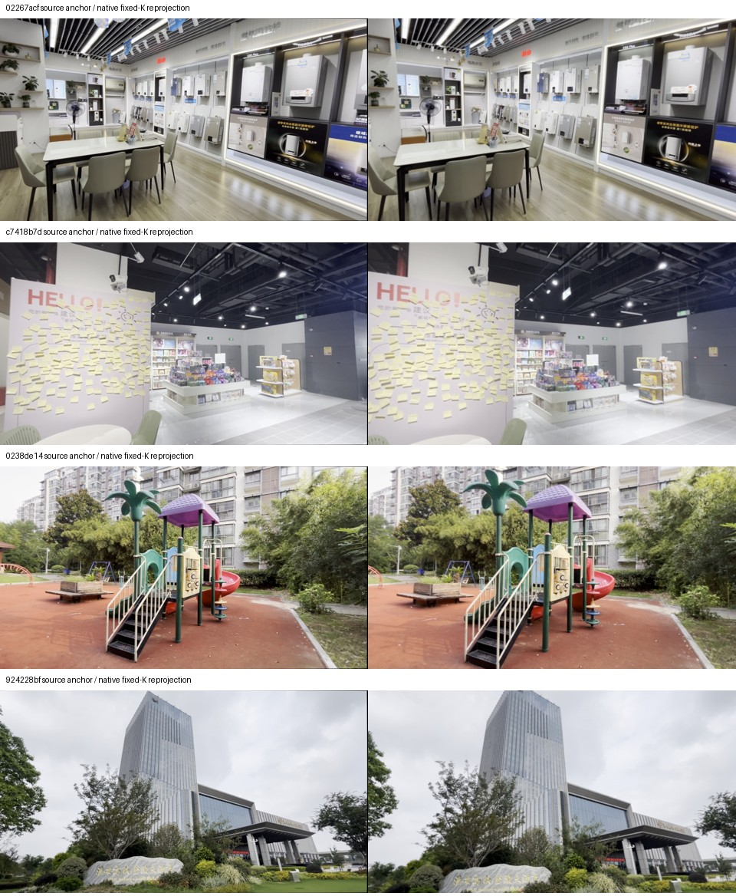

# DreamX input-grid contract: RGB, depth and intrinsics together

The input-grid candidate makes the supplied image geometry agree with the
released DreamX encoder's fixed intrinsics. It does not estimate scale from a
reference trajectory, change model weights, or fit an output score. This is a
camera-contract repair for a separate future-command experiment, not a new
novelty claim or a modification of the frozen memory-only cohort.

## Same rays, same depth units

For source intrinsics `K_s` and the native pixel-grid intrinsics `K_n`, each
output pixel `p_n` samples the original ray at

```
p_s = K_s @ inverse(K_n) @ p_n.
```

RGB and optical-axis z depth use this same map. Camera centre and optical axis
do not change, so depth values retain their units: there is no multiplication
by a focal ratio and no new median-depth normalization. Bilinear interpolation
requires valid source-depth support; missing depth stays NaN. Outside-source
pixels have an explicit coverage mask and cannot become valid geometry through
a fallback depth of one. The actual prepared scenes have full coverage.

The generic `CameraGrid` utility takes only image dimensions and two declared
intrinsics matrices. It has no model name, scene-specific threshold, desired
trajectory or measured response gain. It uses integer OpenCV pixel centres.
An exact-identity branch avoids numerical border loss when the two K matrices
are equal; CPU regressions cover identity, ray consistency, missing depth,
invalid contracts and unit equivariance.

## Actual native contract

Preparation extracts DreamX's released camera encoder and its image-resize
shape from local pinned source. The normalized K is taken from the encoder's
actual **BF16** output and mapped to its **1280 × 704** pixel grid. Both the
input image and anchor depth are prepared directly at that size; the released
resize therefore receives an image already on the target grid. This accounts
for BF16 conditioning quantization as well as nominal focal lengths.

The input-only calibration uses original anchor intrinsics and declared native
K. Offline reference RGB is transformed with its own source-frame intrinsics
for consistent evaluation and visual review; those future RGB frames never
enter generation, online observation or calibration. Original poses, source
frame IDs and metres-per-anchor-unit metadata are copied exactly. Pose-array
truncation to the explicitly declared 69-frame pilot horizon is recorded.

## Preparation evidence and limits

Workspace: `analysis/dreamx_camera_grid_20261103/batch/`. Four original scenes
are prepared: 02267acf, c7418b7d, 0238de14 and 924228bf. The independent 40-pair
cohort retains all its original native horizons and input files.

For all four prepared scenes:

- RGB coverage and valid transformed depth coverage are 100%.
- Recomputed anchor RGB and depth match the saved outputs exactly.
- The first transformed reference RGB equals the prepared input anchor exactly.
- Poses, timestamps and depth-unit metadata are unchanged.
- Every prepared output hash is verified, including 276 offline reference PNGs.

[Original preparation receipt](artifacts/dreamx_camera_grid_20261103/qualification.json),
[current-code verification](artifacts/dreamx_camera_grid_20261103/verification.json),
and [preparation script](artifacts/dreamx_camera_grid_20261103/prepare.py) retain
source/output hashes. The original pre-identity-guard utility is preserved
beside them; the later guard leaves all prepared artifacts byte-identical.



Sampled visual inspection shows the expected narrower field of view and larger
central objects. This is a changed input preprocessing contract, so these runs
must have fresh matched controls. They must not be pooled with historical runs
whose source camera and native conditioning K disagreed. Matching declared
intrinsics is not proof that generated video obeys those intrinsics.

No GPU rollout is claimed here. The remaining future-only integration must
consume this prepared anchor/depth/K together, preserve commanded memory,
use the [explicit native anchor](dreamx_future_preflight_20261103.md), commit
only the next chunk, and pass native/observer no-op parity. The first feedback
command stays nominal. Subsequent accepted observations can drive the separately
frozen recovery ablation; observational execution ratios do not enable inverse
control. GPU/native qualification and efficacy remain outstanding.

Subsequently, the [command-only pilot](dreamx_future_command_20261103.md)
implemented this integration and entered the GPU queue. Its CPU checks pass;
its mandatory GPU parity gates and measured outcomes remain pending.
