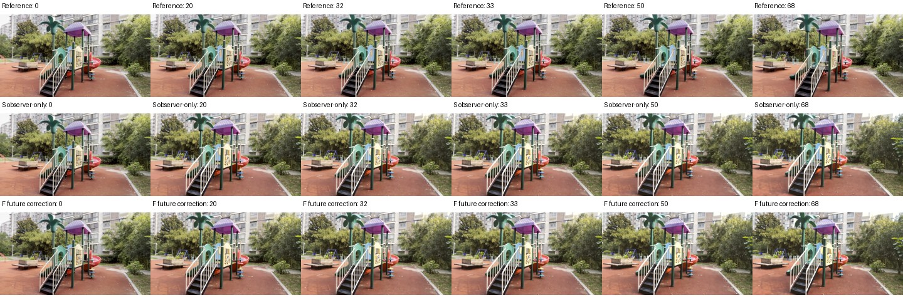
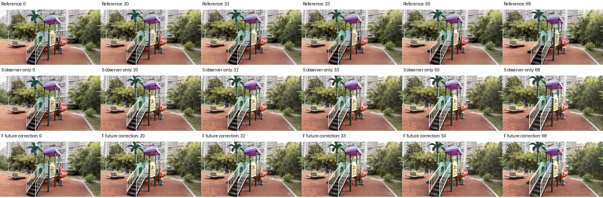

# DreamX command-only pilot: frozen protocol and two moving-scene results

## Moving-scene replication: two seeds, one scene

Both planned seeds on moving development scene `0238de14` have completed all
69 RGB frames. Both pass full A/S identity and S/F prefix/native-state attribution.
Each F run changes three future native chunks after the nominal first feedback;
memory labels stay commanded. This is command correction, with no learned inverse
gain. The two near-stationary cases remain pending at this review snapshot.

| Seed | Mean position S → F | Endpoint position S → F | Mean rotation S → F | Endpoint rotation S → F |
| --- | --- | --- | --- | --- |
| 7 | 0.014894 → 0.013970 (−6.20%) | 0.024509 → 0.022865 (−6.71%) | 0.6067° → 0.6788° | 0.7004° → 0.6119° |
| 107 | 0.026960 → 0.025077 (−6.98%) | 0.042044 → 0.035081 (−16.56%) | 1.8818° → 1.8739° | 1.6294° → 1.6934° |

All metrics above cover frames 33–68 in fixed anchor-depth units, not verified
metres. Both seeds descriptively improve position; rotation changes are mixed.
Two seeds of one scene do not establish generalization or superiority over legacy
rejoin. The native camera contract differs from historical DreamX comparisons.

The [issuance and observer audit](dreamx_future_control_audit_20261103.md)
reproduces both saved command sequences exactly. The speed cap clips no proposed
steps, but online DA3 and offline VIPE disagree substantially on seed 7's residual
direction. This adds a measurement limitation beyond the identical-prefix check.

For seed 107, the absolute mean-position reduction is 0.001883. The independently
fitted trajectories disagree on their identical RGB prefix by mean 0.000850,
p90 0.001322 and maximum 0.001361 position units. Mean/max prefix rotation
disagreement is 0.0490°/0.1005°. This contextual sensitivity is not a calibrated
noise floor or significance test; the second seed does not resolve that limitation.

Direct inspection of six seed-107 timestamps shows a recognizable playground
and similar S/F images, both departing from the reference viewpoint/detail.
No near-total noise collapse or obvious large frame-32→33 jump is visible in
these samples. Full-video continuity and physical camera motion remain unverified.

[Second score](artifacts/dreamx_future_command_20261103/second_result/score.json) ·
[Visual and sensitivity review](artifacts/dreamx_future_command_20261103/second_result/dreamx_0238de14_s107.review.json) ·
[A/S identity](artifacts/dreamx_future_command_20261103/second_result/dreamx_0238de14_s107_identity.json) ·
[S/F attribution](artifacts/dreamx_future_command_20261103/second_result/dreamx_0238de14_s107_attribution.json).

## First completed pair: moving scene 0238de14, seed 7

The first completed case retained the original 69 RGB frames.
A/S observer identity passes for all 69 frames. S/F attribution passes for
frames 0–32, native inputs and shared boundary/cache receipts. F's first feedback
is nominal; its later three accepted observations change three future native
chunks, while memory remains commanded. This qualifies an active future-command
comparison, not a memory intervention or an identified inverse gain.

| Metric, frames 33–68 | S: observer only | F: future correction | Change |
| --- | ---: | ---: | --- |
| Mean position | 0.014894 | 0.013970 | 6.20% lower |
| Endpoint position | 0.024509 | 0.022865 | 6.71% lower |
| Mean rotation | 0.6067° | 0.6788° | 0.0721° higher |
| Endpoint rotation | 0.7004° | 0.6119° | 0.0885° lower |

The six inspected timestamps retain a recognizable playground in both arms;
the videos look similar and both depart from reference viewpoint/detail. There
is no sampled near-total noise collapse. Static samples do not establish smooth
motion or rule out between-sample failure.

The absolute mean-position reduction is only **0.000924 anchor units**. Independent
full-video VIPE fits differ on the identical RGB prefix by mean 0.000538, p90
0.001233 and maximum 0.001344 position units; maximum rotation disagreement is
0.0998°. Different future videos can affect the offline prefix fit. These are
contextual sensitivity measurements, not a calibrated noise floor, confidence
interval or proof that the effect is zero. Statistical and practical benefit
remain unresolved from one scene/seed.

[Score](artifacts/dreamx_future_command_20261103/first_result/score.json) ·
[Visual and prefix-sensitivity review](artifacts/dreamx_future_command_20261103/first_result/dreamx_0238de14_s7.review.json) ·
[Full A/S identity](artifacts/dreamx_future_command_20261103/first_result/dreamx_0238de14_s7_identity.json) ·
[S/F attribution](artifacts/dreamx_future_command_20261103/first_result/dreamx_0238de14_s7_attribution.json).
The remaining cases continue in the frozen queue. This input/FOV contract remains
separate from historical DreamX comparisons.

## Frozen design

This is a separate ablation of future-command correction. The primary
measured-memory v1 method and its original 40-pair cohort remain unchanged.
The pilot tests whether observed lag can usefully change subsequent motion
without rewriting DreamX's native KV memory. Passive execution ratios are
logged; they are not differential gains and do not enable inverse control.

The frozen design has **12 generations**: scenes `0238de14` (moving development)
and `02267acf` (near-stationary stress), seeds 7 and 107, and three arms per case.
Every generation retains the full 69 RGB frames / 18 latents. The prepared
[native camera grid](dreamx_camera_grid_20261103.md) is shared across all arms.
This changed input/FOV contract prevents pooling with historical DreamX runs.

| Arm | Observer | Future commands | Memory |
| --- | --- | --- | --- |
| A | Off | Original plan | Commanded |
| S | On | Original plan | Commanded |
| F | On | Nominal first feedback; subsequent qualified fractional recovery | Commanded |

## Causal issuance and identification limits

The callback runs after the unchanged native context-cache pass. At the first
feedback boundary, RGB is available through frame 20 and the native camera
anchor is frame 17; F leaves the next command nominal. At the next boundary,
RGB ends at 32, the native anchor is 29, and the next native camera samples are
33, 37 and 41. Thus frame **33** is the first potentially affected RGB frame.
Only the next native chunk's tensors are committed; past and later tensors
remain exact. The anchor bridge is described in the
[timeline preflight](dreamx_future_preflight_20261103.md).

The frozen recovery settings are fraction **0.5** and speed budget **2× the
planned native step**, with return motion allowed. These are explicit pilot
hyperparameters, not learned gains, universal optima, or model-specific fitted
calibrations. They supply catch-up headroom absent from the earlier non-reversal
arm. Observation rejection retains absolute commands, but the next relative
camera slice is rebuilt against the last committed anchor. Receipts distinguish
requested correction from a changed native encoding.

DA3 sees emitted RGB and the prepared initial anchor geometry only. Temporary
observer residency is released before continuation; Python, NumPy and Torch RNG
state is preserved. The execution-ratio receipt compares command and measured
motion over the same native-anchor interval. One naturally excited rollout
cannot establish a causal response curve or separate memory/history effects.

## Gates, scoring and current status

1. A and S must match all 69 RGB frames exactly before F is run.
2. S and F must match frames 0–32 and latent/cache/RNG receipts through latent 9.
3. Initial camera and noise inputs must match; the first feedback command is nominal.
4. Independent offline VIPE reports mean position error over frames 33–68,
   endpoint error, rotation, actuation counts and sampled visual evidence.
   Original targets, timestamps and anchor-depth units are retained.

Four CPU tests using the actual released encoder pass, covering nominal parity,
the explicit native anchor, next-slice isolation, rejected-observation rebasing,
and invalid timestamp/intrinsics rejection. The actual source overlay compiles
and native CLI startup passes. At freezing, GPU parity and efficacy were unverified;
the completed two-seed qualification and descriptive results are reported above.

At the original protocol snapshot the queue was waiting for the standard GPU lock.
It has 36 jobs including gates, retention and scoring; required gate failures
hold the affected work. Scientific losses and abstentions remain reportable.
Manifest SHA256:
`226aab81a0601d1476be1b33444aa4cad0dcb4d3b8ee3ccb9912ef7f3cfefb33`.

[Protocol](artifacts/dreamx_future_command_20261103/protocol.json),
[CPU receipt](artifacts/dreamx_future_command_20261103/cpu_validation.json),
[queue snapshot](artifacts/dreamx_future_command_20261103/queue_snapshot.json),
and [source](artifacts/dreamx_future_command_20261103/future_hook.py) preserve
the design and provenance. These are workspace-specific audit copies; the
manifest identifies the complete frozen runtime and inputs in
`analysis/dreamx_future_command_20261103/`.
