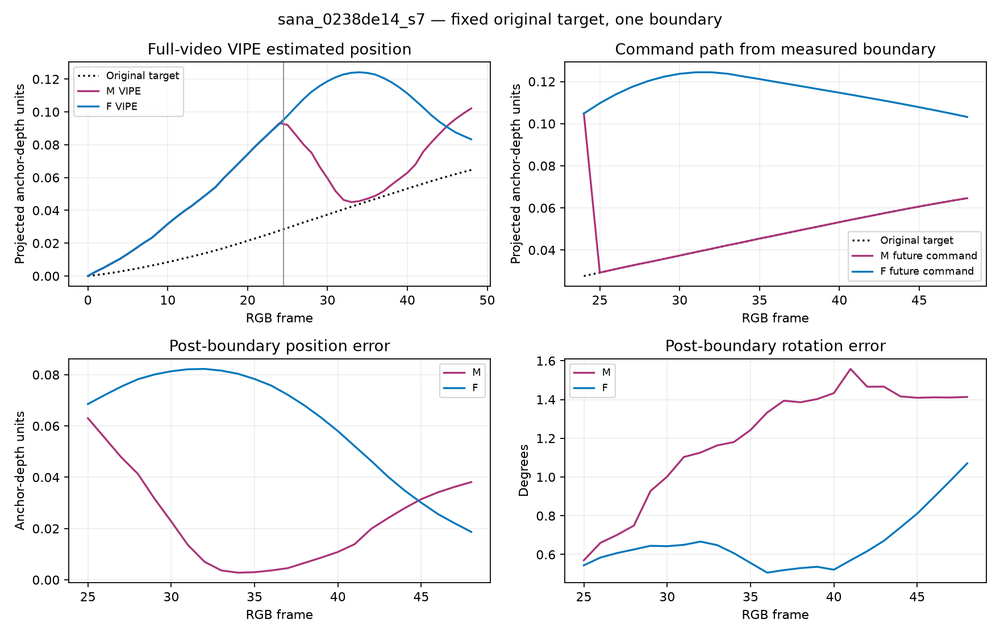
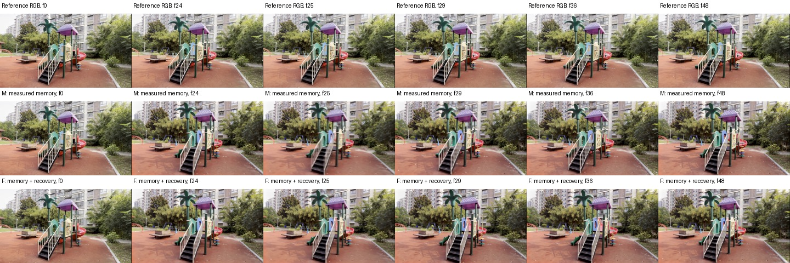
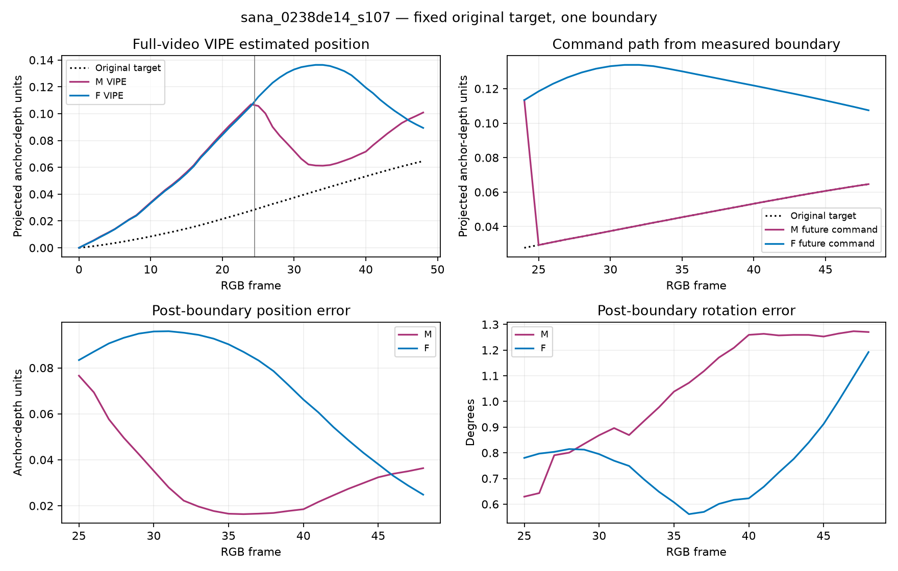

# Fractional recovery: moving-scene visual evidence

Reference recording, generated RGB and fixed-target pose evaluation. Reference pose is observer-derived, not independent dense metric ground truth.

## Seed 7

[Download trajectory PDF](assets/fractional_recovery_20261103/sana_0238de14_s7_trajectories.pdf)

F allows return after overshoot. Its command path first decelerates the incoming overspeed, then returns; VIPE estimates the same broad forward-then-return pattern. M returns sharply and then moves forward again. Mean position error increases from 0.023009 to 0.061150, while endpoint error decreases from 0.038119 to 0.018703 and mean rotation error decreases from 1.205 to 0.656 degrees. This is a timing tradeoff, not evidence of collapse or multi-boundary stability. Shared-prefix VIPE boundary disagreement is 0.002199 anchor units; it is descriptive, not a calibrated noise floor.

## Seed 107

[Download trajectory PDF](assets/fractional_recovery_20261103/sana_0238de14_s107_trajectories.pdf)

As in seed 7, F continues forward while decelerating and then returns toward the target, whereas M returns earlier and subsequently moves forward. Mean position error rises from 0.031748 to 0.072164; endpoint error falls from 0.036357 to 0.024833 and mean rotation error falls from 1.050 to 0.769 degrees. Return is permitted and observed, not counted as failure. One intervention does not establish a persistent limit cycle or its removal.
