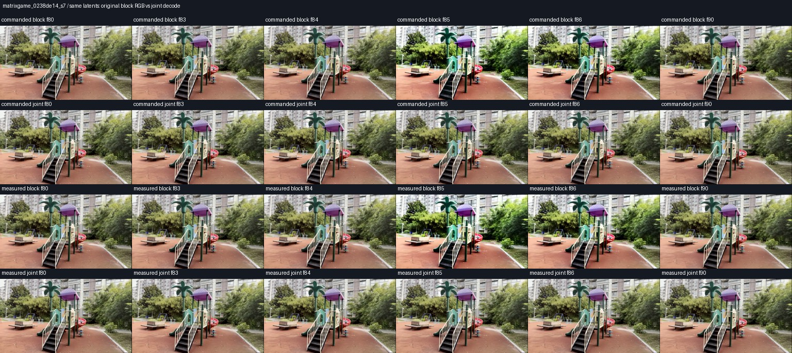
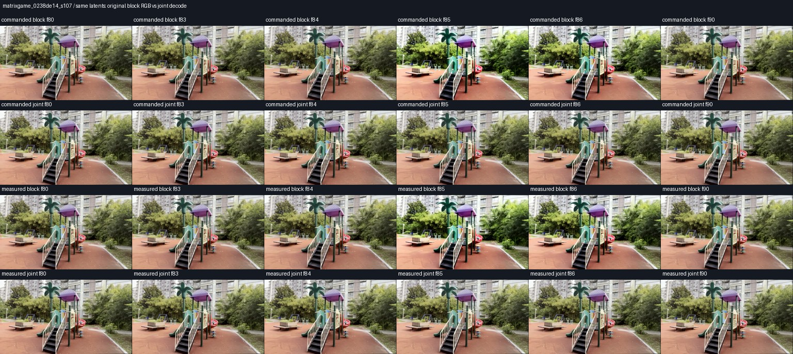

# MatrixGame decoder attribution protocol

MatrixGame's current causal host exports the RGB blocks already seen by its
observer. It skips the released final whole-history VAE decode. Earlier paired
videos show a boundary contrast/saturation seam in both commanded and measured
arms, including zero-write cases. That observation cannot establish a defect
in the released model or a failure of measured-memory correction.

## Identical generated latents, different decoder context

The original four MatrixGame development pairs retain their final latent history:
`(1, 48, 43, 44, 80)` in `torch.bfloat16`, covering 169 RGB frames. This enables an
offline decoder ablation without rerunning diffusion or changing the camera
commands. The selected set is all MatrixGame cases from the original two-scene,
two-seed cohort: `0238de14` and `924228bf`, seeds 7 and 107, both arms.

Each of the eight jobs performs these steps:

1. Load only the released `WanVideoVAE38` checkpoint, with the same BF16 precision
   and native spatial tile size `(30, 52)` and stride `(15, 26)`.
2. Decode history slices `[0:22]` and `[21:43]` separately. Concatenate the first
   85 RGB frames with the last 84 RGB frames, discarding the second clean prefix.
   Require **exact equality to the saved causal RGB**. This control checks that
   the saved history and isolated decoder reproduce the actual export.
3. Decode the same full 43-latent history with the released decoder. Compare the
   first 85 previously emitted frames, per-frame RGB differences, and frame
   adjacency/brightness/contrast around the 84→85 seam.
4. Archive the joint decode losslessly for visual inspection. Preserve every
   original score, reference, command, latent and emitted RGB artifact.

The native VAE decoder explicitly clears its temporal cache at each `decode`
call. Separate block calls therefore reset decoder history. That is a concrete
mechanism to test, not proof that it explains the observed seam. Exact control
replay is required before attributing differences to decoder context.

## Interpretation and limits

If control replay succeeds and whole-history decoding reduces the seam, it
isolates a decoder/export contribution while holding generated latents fixed.
If it does not, the seam remains unresolved. If the first 85 frames change,
whole-history decoding also changes previously emitted observations and cannot
silently replace the causal loop. Even if those frames match, a state-preserving
streaming implementation would need separate equivalence and resource checks.
Pixel seams are appearance measures, not camera velocities or pose errors.

This is an offline diagnostic, not an additional camera-control method or an
updated efficacy score. It does not repair the current cohort mid-run. Native
whole-history output and the causal export must be labeled separately in any
paper or webpage comparison.

## Completed GPU audit

All eight jobs completed, and every separate-block replay is byte-identical to
its original 169-frame RGB export. The same-latent comparison is therefore
qualified for decoder attribution. Direct inspection of frames 80, 83, 84, 85,
86 and 90 in all four pairs shows a conspicuous contrast/saturation pulse at
frame 85 in the separate-block exports. Whole-history decoding suppresses that
pulse in both arms, preserving recognizable content in these samples.

| Scene / seed | Arm | RGB MAE at 84→85: block → joint | Reduction | Previously emitted 85 frames exact? |
| --- | --- | ---: | ---: | --- |
| 0238de14_s107 | commanded | 19.763 → 4.947 | 75.0% | No |
| 0238de14_s107 | measured | 20.962 → 11.187 | 46.6% | No |
| 0238de14_s7 | commanded | 20.889 → 5.257 | 74.8% | Yes |
| 0238de14_s7 | measured | 20.703 → 6.393 | 69.1% | Yes |
| 924228bf_s107 | commanded | 20.384 → 1.897 | 90.7% | No |
| 924228bf_s107 | measured | 20.384 → 1.897 | 90.7% | No |
| 924228bf_s7 | commanded | 20.232 → 1.722 | 91.5% | No |
| 924228bf_s7 | measured | 20.232 → 1.722 | 91.5% | No |

Units are 8-bit RGB levels. The reduction is a descriptive adjacent-frame
appearance statistic, **not a camera-error reduction**. These are eight arm
exports from four pairs on two scenes; the zero-write pairs reuse identical
policy outputs and are not independent intervention effects.

This isolates a decoder/export contribution to the visible seam while keeping
latents fixed. It does not establish that all boundary variation comes from
decoding: the moving-scene measured seed-107 joint export still has an 11.187
RGB-level adjacent difference, versus 4.947 in its commanded arm. Motion and
geometry consistency would need separate assessment.

Six exports change previously emitted RGB. Their largest prior-frame mean
absolute differences are small (at most 0.042 RGB levels), but they are not
byte-identical. Thus the joint decode cannot silently replace observations the
online controller already consumed. Existing causal videos and scores are
preserved. A causal decoder repair would require a separate host implementation,
identity/prefix controls and matched reruns; the current generation queue is
not changed by this diagnostic.

[All numeric results](artifacts/generalization_20261103/matrix_decoder_audit/summary.json),
[visual provenance and observations](artifacts/generalization_20261103/matrix_decoder_audit/manifest.json),
and [terminal queue state](artifacts/generalization_20261103/matrix_decoder_audit/status.json)
retain the complete eight-arm evidence. The original
[protocol](artifacts/generalization_20261103/matrix_decoder_audit/protocol.json)
remains unchanged. Workspace:
`analysis/memory_generalization_20261103/matrix_decoder_audit/`.
