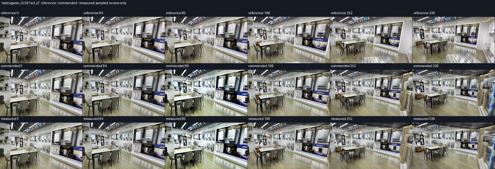
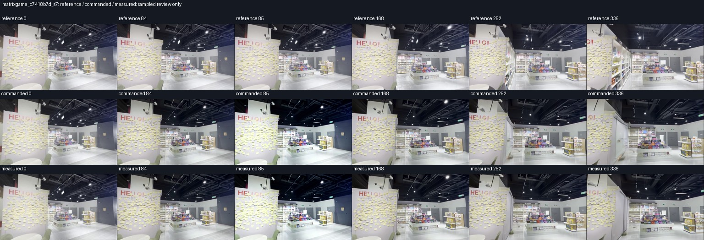
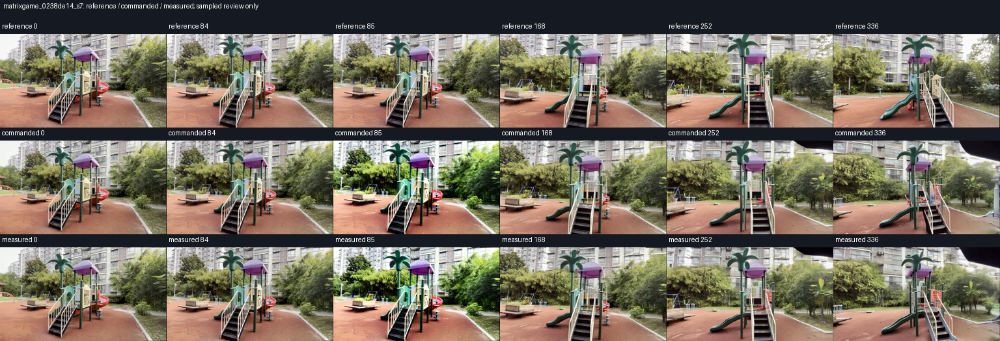
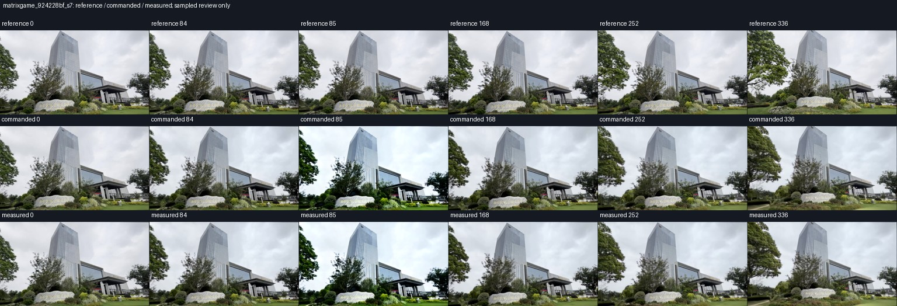
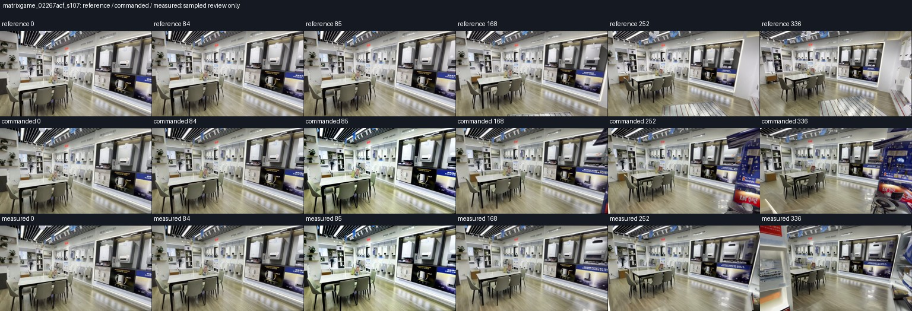
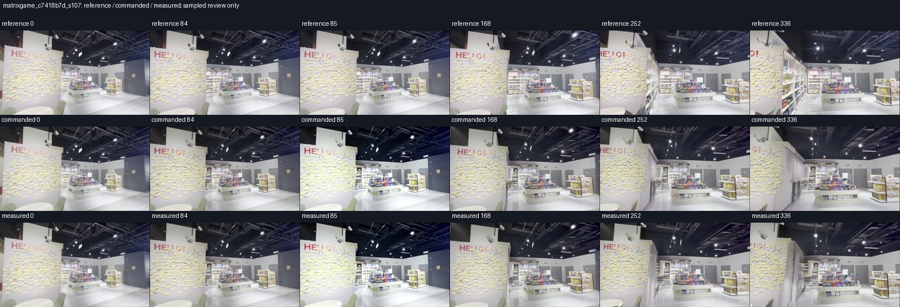
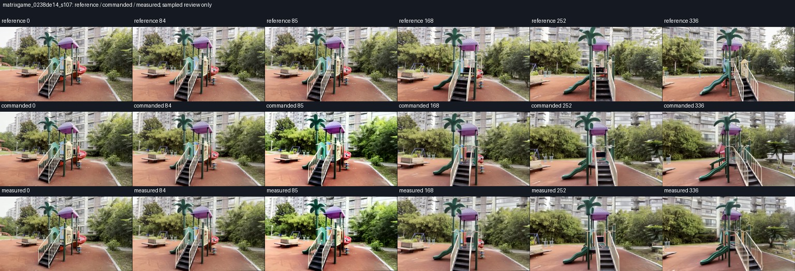

# MatrixGame: first seven full-horizon paired results

The observer-lifetime retry has completed seven of the eight prespecified MatrixGame pairs at the original **337 RGB frames**, with the first affected frame at **85**. All seven pass exact pre-intervention RGB equality. The first commanded retry is byte-identical across all 337 frames to the original completed baseline. The resource fix changes observer lifetime; it does not shorten the run or change the memory policy. The original failed attempt remains in the execution record. The seventh pair finished scoring after a [disk-hold resume](queue_disk_resume_20261103.md); it was not regenerated.

These seven qualified retries bring unique qualified cohort coverage to **23 / 40** pairs: eight LingBot, eight DreamX and seven MatrixGame. This is a partial, dated snapshot; it does not establish benefit across the five-model cohort.

| Scene / seed | Writes | Mean position, commanded → measured | Reduction | Mean rotation, degrees | Sampled RGB interpretation |
| --- | ---: | --- | ---: | --- | --- |
| 02267acf_s7 | 3 | 0.009246 → 0.009012 | +2.53% | 0.2475 → 0.2197 | Small numeric pose improvement with retained scene content and appearance drift; efficacy not established. |
| c7418b7d_s7 | 3 | 0.027582 → 0.009028 | +67.27% | 0.3255 → 0.2794 | Numeric position benefit with recognizable scene and appearance drift; sampled review does not establish clean visual success. |
| 0238de14_s7 | 3 | 0.010156 → 0.013006 | -28.06% | 0.4160 → 0.3075 | Position regression despite lower mean rotation; recognizable playground with appearance artifacts. |
| 924228bf_s7 | 0 | Unavailable in both arms | — | 0.1812 → 0.1812 | Abstention with unavailable position registration; not an active correction success. |
| 02267acf_s107 | 3 | 0.016961 → 0.010633 | +37.31% | 0.3846 → 0.3354 | Numeric pose improvement with substantial foreground hallucination in both arms; visual fidelity tradeoff. |
| c7418b7d_s107 | 3 | 0.044111 → 0.007786 | +82.35% | 0.8714 → 0.3542 | Lower position and rotation errors with recognizable scene; appearance/layout drift remains. |
| 0238de14_s107 | 3 | 0.010054 → 0.008280 | +17.64% | 0.5736 → 0.7399 | Lower mean position with worse endpoint position and rotation; recognizable playground with appearance/layout drift. |

Five of six position-valid pairs have lower mean position error; one worsens. Five have lower mean rotation error and one worsens; three have higher endpoint rotation error. These are numeric directions, not statistically established wins. Position uses fixed reference anchor-depth units, not established metres; reference trajectories may themselves be VIPE-derived. No raw-error average is pooled across scenes or models.

The small `02267acf/s7` position reduction is only 0.000234 anchor units and lacks a matched regeneration/noise floor. The stronger percentage on `02267acf/s107` accompanies large invented foreground structures in both arms. On moving scene `0238de14/s7`, mean position worsens 28.06%, even though mean rotation improves. These qualifications remain attached to the results.

The second moving-scene seed, `0238de14/s107`, changes the direction of the mean-position result: 17.64% lower error. However, endpoint position rises 1.26% (0.018663 → 0.018899), mean rotation rises 29.00% (0.5736° → 0.7399°), and endpoint rotation rises 56.22% (1.2631° → 1.9732°). Both sampled videos retain the playground, with a contrast pulse and layout/detail drift. The two seeds do not establish a consistent tracking benefit. This comparison is measured memory versus commanded memory, not a legacy-rejoin comparison.

`924228bf/s7` accepts zero writes and has unavailable position registration in both arms. Its identical rotation score is an abstention result, not a correction success. The [all-frame RGB receipt](artifacts/generalization_20261103/matrix_full_horizon_review/matrixgame_924228bf_s7.abstention_rgb.json) verifies exact equality of all 337 decoded RGB frames, dimensions and timestamps.

The sampled images below show a contrast pulse at frame 85 in both arms. The [independent decoder audit](matrix_decoder_audit_20261103.md) establishes a decoder/export contribution in earlier 169-frame runs; it does not prove that every seam or pose regression here is caused by the decoder. Whole-history diagnostic exports have not replaced these causal online videos or scores.

This is direct, unblinded inspection of six matched timestamps per arm, not a full-video review, a calibrated appearance metric, or evidence resolving physical reversals. Recognizable samples do not rule out intervening failures. No near-total scene loss is visible in these samples; foreground hallucinations and appearance changes remain visible.

[Review manifest](artifacts/generalization_20261103/matrix_full_horizon_review/manifest.json) · [full-baseline resource parity](artifacts/generalization_20261103/matrix_full_horizon_review/resource_prefix.json) · [all 40 cases and preserved execution attempts](generalization_coverage_20261103.json). Audit scripts are workspace-specific archival copies; their original locations are recorded in the manifest.

The review script now supports incremental additions. It verifies existing score,
gate, archive, reference-image and sheet hashes before reusing a review; the seven
existing review records remain unchanged. An explicit request for an unqualified
pair fails without changing the manifest. This reduces repeated decoding while
preserving the evidence behind each inspection. [Validation](artifacts/generalization_20261103/matrix_full_horizon_review/incremental_review_validation.json).

**matrixgame_02267acf_s7**

[Inspection notes](artifacts/generalization_20261103/matrix_full_horizon_review/matrixgame_02267acf_s7.review.json) · [score](artifacts/generalization_20261103/matrix_full_horizon_review/matrixgame_02267acf_s7.score.json)

**matrixgame_c7418b7d_s7**

[Inspection notes](artifacts/generalization_20261103/matrix_full_horizon_review/matrixgame_c7418b7d_s7.review.json) · [score](artifacts/generalization_20261103/matrix_full_horizon_review/matrixgame_c7418b7d_s7.score.json)

**matrixgame_0238de14_s7**

[Inspection notes](artifacts/generalization_20261103/matrix_full_horizon_review/matrixgame_0238de14_s7.review.json) · [score](artifacts/generalization_20261103/matrix_full_horizon_review/matrixgame_0238de14_s7.score.json)

**matrixgame_924228bf_s7**

[Inspection notes](artifacts/generalization_20261103/matrix_full_horizon_review/matrixgame_924228bf_s7.review.json) · [score](artifacts/generalization_20261103/matrix_full_horizon_review/matrixgame_924228bf_s7.score.json)

**matrixgame_02267acf_s107**

[Inspection notes](artifacts/generalization_20261103/matrix_full_horizon_review/matrixgame_02267acf_s107.review.json) · [score](artifacts/generalization_20261103/matrix_full_horizon_review/matrixgame_02267acf_s107.score.json)

**matrixgame_c7418b7d_s107**

[Inspection notes](artifacts/generalization_20261103/matrix_full_horizon_review/matrixgame_c7418b7d_s107.review.json) · [score](artifacts/generalization_20261103/matrix_full_horizon_review/matrixgame_c7418b7d_s107.score.json)

**matrixgame_0238de14_s107**

[Inspection notes](artifacts/generalization_20261103/matrix_full_horizon_review/matrixgame_0238de14_s107.review.json) · [score](artifacts/generalization_20261103/matrix_full_horizon_review/matrixgame_0238de14_s107.score.json)
