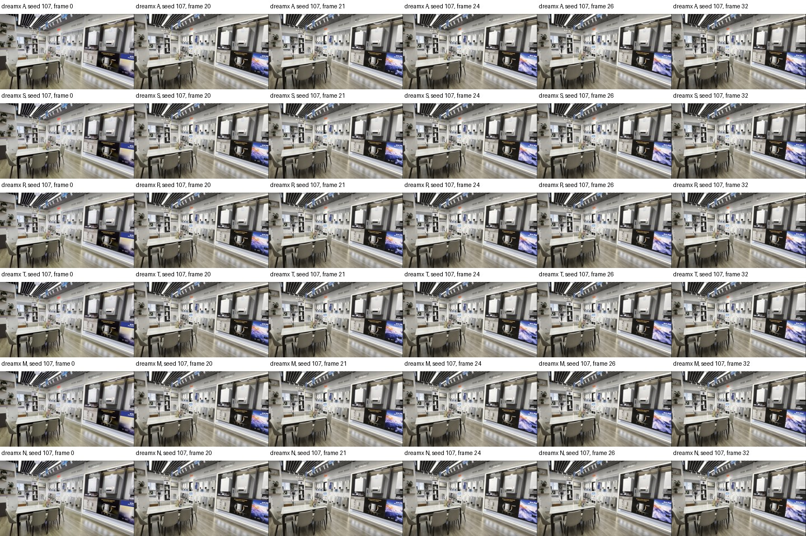
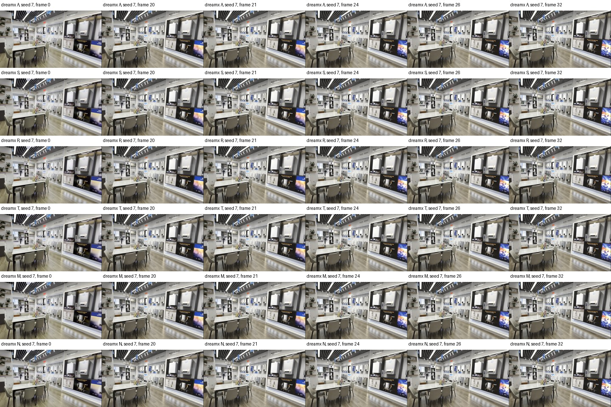
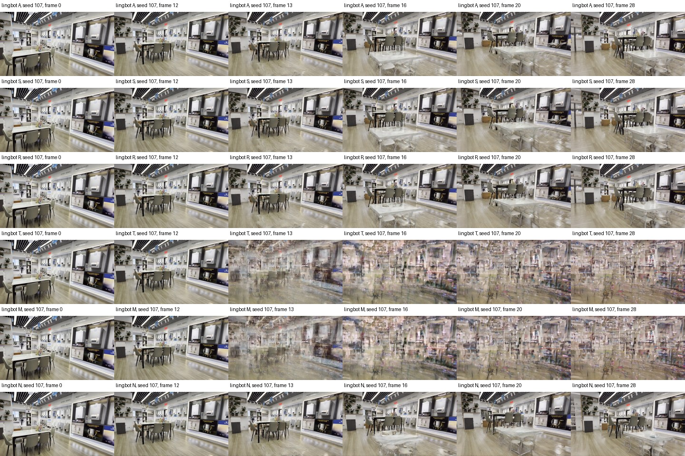
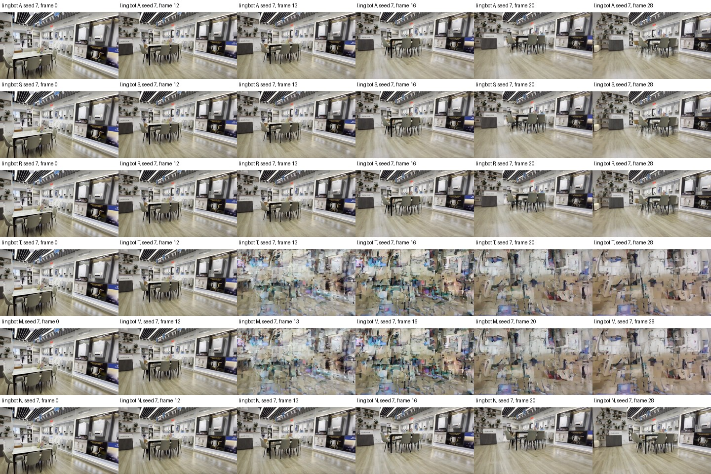
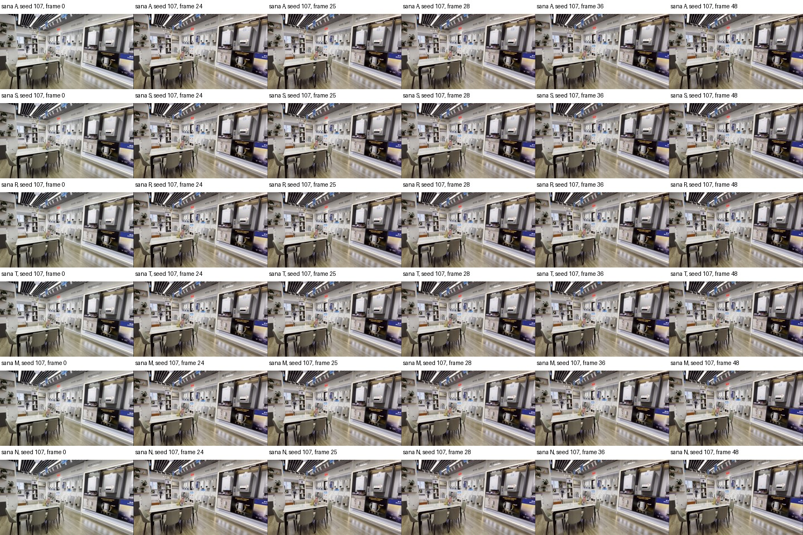
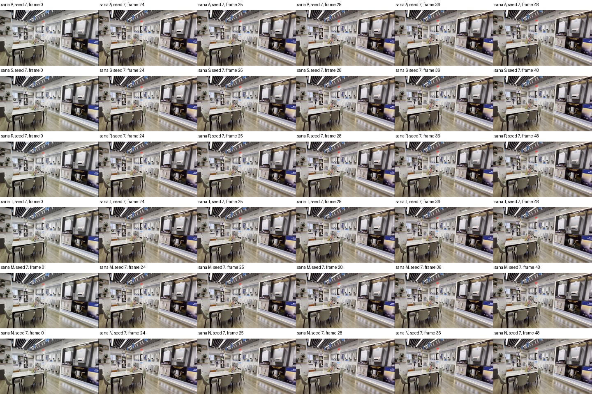
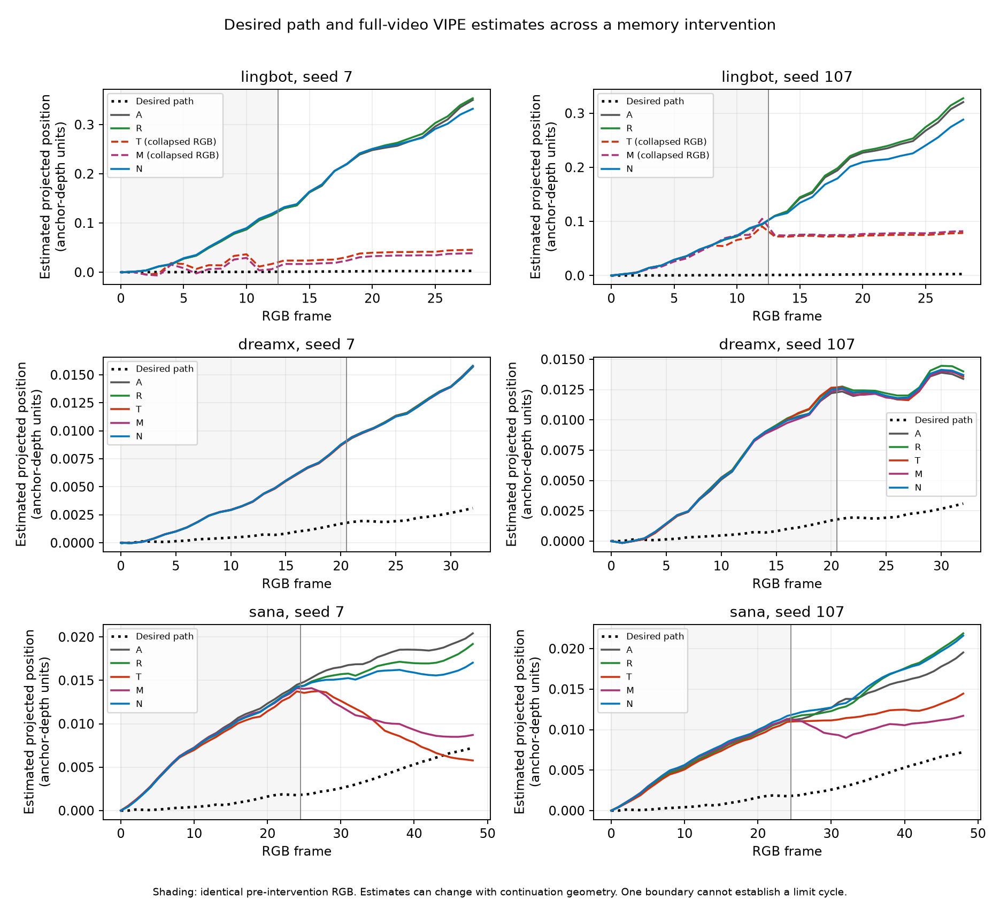

# Cross-model memory diagnostic visual gallery

All labels are retrospective sampled inspection. Reference RGB is a recorded video, not independent physical pose ground truth. See [the report](memory_components_20261102.md) for scope and limitations.

## New matched components

### dreamx_02267acf_s107

[Pose estimates and identical-prefix disagreement](assets/memory_components_20261102/dreamx_02267acf_s107_pose_diagnostics.png) · [PDF](assets/memory_components_20261102/dreamx_02267acf_s107_pose_diagnostics.pdf)

### dreamx_02267acf_s7

[Pose estimates and identical-prefix disagreement](assets/memory_components_20261102/dreamx_02267acf_s7_pose_diagnostics.png) · [PDF](assets/memory_components_20261102/dreamx_02267acf_s7_pose_diagnostics.pdf)

### lingbot_02267acf_s107

[Pose estimates and identical-prefix disagreement](assets/memory_components_20261102/lingbot_02267acf_s107_pose_diagnostics.png) · [PDF](assets/memory_components_20261102/lingbot_02267acf_s107_pose_diagnostics.pdf)

### lingbot_02267acf_s7

[Pose estimates and identical-prefix disagreement](assets/memory_components_20261102/lingbot_02267acf_s7_pose_diagnostics.png) · [PDF](assets/memory_components_20261102/lingbot_02267acf_s7_pose_diagnostics.pdf)

### sana_02267acf_s107

[Pose estimates and identical-prefix disagreement](assets/memory_components_20261102/sana_02267acf_s107_pose_diagnostics.png) · [PDF](assets/memory_components_20261102/sana_02267acf_s107_pose_diagnostics.pdf)

### sana_02267acf_s7

[Pose estimates and identical-prefix disagreement](assets/memory_components_20261102/sana_02267acf_s7_pose_diagnostics.png) · [PDF](assets/memory_components_20261102/sana_02267acf_s7_pose_diagnostics.pdf)

## Estimated motion across the boundary

[PDF](assets/memory_components_20261102/progress_plot.pdf)

## Expanded v1 reference comparisons

| Pair | Sampled visual observation |
|---|---|
| [lingbot_0238de14_s7](assets/memory_components_20261102/expanded_review_lingbot_0238de14_s7.jpg) | Recognizable playground in both arms. Measured arm has less lateral displacement of the play structure; some ghosting around rails. No severe patchwork collapse in samples. |
| [lingbot_0238de14_s107](assets/memory_components_20261102/expanded_review_lingbot_0238de14_s107.jpg) | Recognizable playground in both arms. Measured arm shows pronounced duplicated/ghosted rails and supports after the boundary. No severe patchwork collapse, but visible geometry degradation; position reduction must be read with worse rotation. |
| [lingbot_924228bf_s7](assets/memory_components_20261102/expanded_review_lingbot_924228bf_s7.jpg) | Both arms visually identical in the displayed samples, consistent with zero accepted memory writes. Building remains recognizable. This is abstention, not evidence of active memory efficacy. |
| [lingbot_924228bf_s107](assets/memory_components_20261102/expanded_review_lingbot_924228bf_s107.jpg) | Both arms visually identical in the displayed samples, consistent with zero accepted memory writes. Building remains recognizable. This is abstention, not evidence of active memory efficacy. |
| [sana_0238de14_s7](assets/memory_components_20261102/expanded_review_sana_0238de14_s7.jpg) | Both arms recognizable. Commanded arm moves the play structure much farther to the right than reference; measured arm stays visually closer in these samples. No severe collapse; geometry and rotation are not independently verified. |
| [sana_0238de14_s107](assets/memory_components_20261102/expanded_review_sana_0238de14_s107.jpg) | Both arms recognizable. Commanded arm moves the play structure much farther to the right than reference; measured arm stays visually closer in these samples. Some rail ghosting; no severe collapse. |
| [sana_924228bf_s7](assets/memory_components_20261102/expanded_review_sana_924228bf_s7.jpg) | Both arms visually identical in the displayed samples, consistent with zero accepted memory writes. Building remains recognizable. This is abstention, not evidence of active memory efficacy. Both continuations depart visibly from the nearly stationary reference; the uncorrected drift remains. |
| [sana_924228bf_s107](assets/memory_components_20261102/expanded_review_sana_924228bf_s107.jpg) | Both arms visually identical in the displayed samples, consistent with zero accepted memory writes. Building remains recognizable. This is abstention, not evidence of active memory efficacy. Both continuations depart visibly from the nearly stationary reference; the uncorrected drift remains. |
| [dreamx_0238de14_s7](assets/memory_components_20261102/expanded_review_dreamx_0238de14_s7.jpg) | Both arms recognizable and visually nearly identical. No sampled severe collapse; no visible substantial control improvement. |
| [dreamx_0238de14_s107](assets/memory_components_20261102/expanded_review_dreamx_0238de14_s107.jpg) | Both arms recognizable and visually nearly identical. No sampled severe collapse; no visible substantial control improvement. |
| [dreamx_924228bf_s7](assets/memory_components_20261102/expanded_review_dreamx_924228bf_s7.jpg) | Both arms visually identical in the displayed samples, consistent with zero accepted memory writes. Building remains recognizable. This is abstention, not evidence of active memory efficacy. |
| [dreamx_924228bf_s107](assets/memory_components_20261102/expanded_review_dreamx_924228bf_s107.jpg) | Both arms visually identical in the displayed samples, consistent with zero accepted memory writes. Building remains recognizable. This is abstention, not evidence of active memory efficacy. |
| [matrixgame_0238de14_s7](assets/memory_components_20261102/expanded_review_matrixgame_0238de14_s7.jpg) | Both arms recognizable. Strong contrast/saturation seam at frame 85 in both arms, then recovery. Measured arm ends with smaller visual displacement than commanded; score position worsens. No severe collapse. |
| [matrixgame_0238de14_s107](assets/memory_components_20261102/expanded_review_matrixgame_0238de14_s107.jpg) | Both arms recognizable. Strong contrast/saturation seam at frame 85 in both arms, then recovery. Different continuation viewpoints; no severe collapse. |
| [matrixgame_924228bf_s7](assets/memory_components_20261102/expanded_review_matrixgame_924228bf_s7.jpg) | Both arms visually identical in the displayed samples, consistent with zero accepted memory writes. Building remains recognizable. This is abstention, not evidence of active memory efficacy. Contrast/saturation seam appears in both arms at frame 85. |
| [matrixgame_924228bf_s107](assets/memory_components_20261102/expanded_review_matrixgame_924228bf_s107.jpg) | Both arms visually identical in the displayed samples, consistent with zero accepted memory writes. Building remains recognizable. This is abstention, not evidence of active memory efficacy. Contrast/saturation seam appears in both arms at frame 85. |
| [lyra_0238de14_s7](assets/memory_components_20261102/expanded_review_lyra_0238de14_s7.jpg) | Both arms recognizable, with modest viewpoint/structure differences. Measured continuation roughly follows the reference play-structure position. No severe collapse; lower position error with a small angular change (0.044° to 0.122°), significance unresolved. |
| [lyra_0238de14_s107](assets/memory_components_20261102/expanded_review_lyra_0238de14_s107.jpg) | Both arms recognizable, with modest viewpoint/structure differences. No severe collapse; lower position error with a small angular change (0.027° to 0.188°), significance unresolved. |

## Earlier seven-writer pairs

- [astronex](assets/memory_components_20261102/historical_review_astronex.jpg)
- [dreamx](assets/memory_components_20261102/historical_review_dreamx.jpg)
- [lingbot](assets/memory_components_20261102/historical_review_lingbot.jpg)
- [lyra](assets/memory_components_20261102/historical_review_lyra.jpg)
- [matrixgame](assets/memory_components_20261102/historical_review_matrixgame.jpg)
- [sana](assets/memory_components_20261102/historical_review_sana.jpg)
- [worldwarp](assets/memory_components_20261102/historical_review_worldwarp.jpg)
