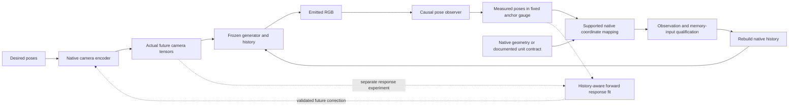

# Cross-model diagnosis of measured-memory camera control

This extends the earlier LingBot mechanism audit to other model interfaces. The experiment separates measured rotation, measured translation, full measured pose, and an artificial translation-amplitude intervention. It also reviews saved pairs for all seven implemented memory writers and all 18 completed expanded-v1 pairs against their reference RGB. The eleven-model coverage table below distinguishes new generations, historical evidence, and source-only checks.

**Current conclusion:** the 36 component runs diagnose one near-stationary scene, not general performance. LingBot's selected failure follows measured translation divided by a tiny plan-only normalizer. DreamX's tested memory replay barely changes RGB. SANA's return after overshoot can be valid correction, not evidence of instability. Its stronger moving-scene evidence is the 81–85% position reduction below, with a 0.5° to about 1.0–1.2° rotation tradeoff. Lyra's angular changes are small in absolute terms; their significance is unresolved. See the [framing correction and next-test specification](framing_review_20261103.md).

This is selected development evidence, not a held-out generalization test. The frozen v1 algorithm, thresholds, historical scores, native checkpoints, and existing broad-queue holds are unchanged. No deployment probes or fitted model-specific constants are introduced.

## Matched component protocol

Scene `02267acf`, seeds 7 and 107, six arms per model:

| Arm | Native memory labels |
|---|---|
| A | Original commanded poses; observation overhead retained |
| S | Identity re-encoding/replay of commanded poses |
| R | Measured c2w rotation, commanded native camera-center translation |
| T | Commanded c2w rotation, measured native camera-center translation |
| M | Full measured native c2w pose |
| N | Measured rotation; measured translation multiplied by a prefix-derived amplitude factor |

For N, the factor is `min(1, max_norm(commanded_prefix_centers) / max_norm(measured_prefix_centers))`. Norms refer to each adapter's actual native representation. N is an artificial intervention that tests input amplitude; it is **not** a physically calibrated measured pose, a learned unit conversion, or a deployment recommendation.

LingBot uses framewise relative c2w divided by the original planned-step normalizer. DreamX uses c2w relative to the preceding chunk endpoint, before PRoPE inversion and bfloat16 conversion. SANA uses anchor-relative metric c2w before raymap/Plücker packing. Separating rotation and camera-center translation is representation-dependent; these arms are not asserted to be physically interchangeable across adapters.

Horizons are 29 RGB frames for LingBot, 33 for DreamX, and 49 for SANA. The first affected RGB frames are 13, 21, and 25 respectively. These are one-boundary mechanism tests. Every case requires exact common-prefix RGB, exact unchanged future native camera inputs across all six arms, and full A/S RGB equality. One causal DA3 prefix observation is reused only after exact RGB, K, depth and query-identity checks. Python, NumPy and Torch RNG states are preserved. Observer rejections are retained.

VIPE evaluates each distinct video with RGB, processed intrinsics and initial-anchor depth registration, without fitting the generated trajectory to the target. Identical full RGB is cached under a bound evaluator contract. Position is in fixed anchor-depth units, not independently verified metres. Pose estimates and visual review are separate outcomes.

## LingBot: translation isolates the selected failure

| Seed | Arm | Mean position error | Mean rotation error (degrees) | Sampled visual result |
|---|---|---:|---:|---|
| 7 | A / S | 0.31740 | 2.379 | Recognizable |
| 7 | R | 0.31970 | 2.339 | Recognizable |
| 7 | T | 0.09214 | 3.965 | Severe patchwork corruption |
| 7 | M | 0.09381 | 3.845 | Severe patchwork corruption |
| 7 | N | 0.30875 | 2.162 | Recognizable; limited tracking change |
| 107 | A / S | 0.26042 | 2.568 | Recognizable |
| 107 | R | 0.26370 | 2.624 | Recognizable |
| 107 | T | 0.10741 | 4.474 | Severe patchwork corruption |
| 107 | M | 0.09905 | 2.587 | Severe patchwork corruption |
| 107 | N | 0.24912 | 2.732 | Recognizable; limited tracking change |

All attribution controls pass. The full measured translation component is sufficient for this observed failure under these two matched conditions. Rotation alone does not reproduce it. Reducing translation amplitude while retaining measured rotation avoids the sampled severe collapse, but N's position change is modest and rotation is mixed. This advances the earlier diagnosis without establishing a universally safe amplitude or a successful controller.

For seed 7, the original plan normalizer is `0.0007368588703684509`. The full native plan's maximum step is 1; its observed prefix maximum is 0.74123. The measured prefix maximum is 105.61508, or 142.49 times the commanded **prefix** maximum. N therefore applies 0.0070182. These ratios describe this run's encoding; they do not establish the model's training support or identify physical units.

This is strongly scene-conditioned. At 77 frames the target has maximum RGB
step 0.000420 and net translation 0.01338. On moving scene `0238de14`, saved
measured native steps peak at 8.37/7.50 under a plan normalizer of 0.0065074;
those continuations remain recognizable. The priority is a consistent encoder
denominator covering plan and observed history, with all retained state and
future inputs re-encoded together. This is an operational normalization problem;
a search for an arbitrary physical-to-native scalar is not its proposed remedy.
The common-denominator change and its support/abstention gate still require
qualification. N changed history alone and does not validate that replacement.

### Why the lower corrupted-video pose errors are misleading

Full-video VIPE changes the estimated poses of the identical RGB prefix after seeing the corrupted continuation. In seed 7, maximum prefix position disagreement from A is 0.00073 for R, 0.16397 for T, 0.17139 for M, and 0.00338 for N. Initial-anchor registration still passes. The continuation can therefore affect the offline observer's reconstruction of a shared past.

This is a diagnostic of estimator dependence, not a calibrated uncertainty estimate. Reusing one scalar registration scale across independent SLAM reconstructions would not repair different gauges or geometry. Failed videos remain in the policy denominator, with their failure labels; their low position scores are not tracking successes.

The new seed-7 A/S/M videos are pixel-identical to the earlier mechanism run, but the earlier independent VIPE executions give different small numerical values. Exact RGB reuse within the new evaluator contract removes that avoidable A/S discrepancy; it does not remove geometric ambiguity on different videos.

## DreamX: small intervention response, with unresolved camera semantics

Both seeds preserve recognizable room geometry across all six arms. Their intervention differences are visually small; A/S are exact. For seed 7, mean position error ranges only from 0.03663 to 0.03672, versus A's 0.03668. Mean rotation errors range from 0.498 to 0.505 degrees. Post-boundary pixel MAE against A is approximately 0.39–0.46 on a 0–255 scale (seed 107: 0.48–0.53). This is evidence of a small effect under the tested interface, not a demonstrated control improvement.

These arms never vary the future camera inputs. They identify the effect of the tested memory intervention, not a differential future-command gain. The CPU encoder check below likewise establishes input behavior rather than generator response.

The tested context-noise KV re-pass is therefore a weak actuator here. DreamX's
next control experiment should vary future commands with memory held fixed.
Earlier later-history probes recorded a VIPE projected gain of 0.1217, but
other histories/seeds disagreed and the inverse-control screen remained closed.
This is not a universal per-step gain or proof that every possible memory
intervention is inert.

Seed-7 measured/commanded prefix translation amplitude is about 12.44, yet it does not reproduce LingBot's collapse. Ratios have different representation semantics across models, and no universal ratio threshold is established.

DreamX's native translation units remain unqualified. In this scene its actual quantized conditioning focal lengths are about 12.1–12.2% above the scene intrinsics used by the observer. That mismatch alone is not proof of a proportional translation error, and changing only observer K is not a validated correction. The earlier e43058cb probe scene had less than 1% focal mismatch; this new finding does not explain away its small differential response. Both findings must remain scoped to the tested camera interface rather than a claim of intrinsic model uncontrollability.

## SANA: coherent tracking changes, with seed-dependent return motion

Both seeds complete all six arms with exact prefix, future-camera and identity controls. All sampled continuations remain recognizable, including T and M. Full measured memory lowers both pose scores in each selected case. Translation alone improves position in both, but slightly worsens rotation in seed 7.

| Seed | Arm | Mean position error | Mean rotation error (degrees) | VIPE net projected continuation |
|---|---|---:|---:|---:|
| 7 | A / S | 0.01442 | 0.467 | +0.00592 |
| 7 | R | 0.01314 | 0.459 | +0.00492 |
| 7 | T | 0.00986 | 0.499 | −0.00796 |
| 7 | M | 0.00994 | 0.366 | −0.00538 |
| 7 | N | 0.01205 | 0.459 | +0.00280 |
| 107 | A / S | 0.01426 | 0.898 | +0.00832 |
| 107 | R | 0.01423 | 0.593 | +0.01061 |
| 107 | T | 0.01028 | 0.574 | +0.00350 |
| 107 | M | 0.00873 | 0.410 | +0.00038 |
| 107 | N | 0.01333 | 0.571 | +0.00992 |

Progress is the boundary-to-end displacement projected along the planned continuation, in anchor-depth units. The lower position errors in seed 7 accompany backward estimated progress for T and M. The effect is seed dependent: seed 107 T stays forward, and M has almost zero projected progress. One boundary cannot establish a limit cycle. A scene can remain recognizable and score better while still showing a return toward an earlier overshot target.

That return is consistent with faithful measured labels: the represented camera
has passed the target and the unchanged future target lies behind it. Backward
progress alone is not a failure criterion. The completed bounded-continuation
ablation [reports higher position error when suppressing that return](memory_rate_20261102.md);
it does not refute measured-memory correction or supersede the moving-scene
results below. Repeated overshoot, error growth, or oscillation require a
multi-boundary test.

### Post-hoc DA3 check of motion direction

After seeing the seed-7 VIPE return, a separately hashed diagnostic measured the same completed A/T/M videos in both seeds with DA3. It used only emitted RGB, the same processed intrinsics and initial reference anchor depth, queried frames 24 and 48, and generated no new videos. All six measurements passed the existing observer gate. This check was selected after the finding; it is not a prespecified confirmatory test. DA3 is distinct from the VIPE scorer but also supplies the method's online memory observations.

| Seed | Arm | DA3 projected progress | VIPE projected progress | 3D displacement cosine |
|---|---|---:|---:|---:|
| 7 | A | +0.00298 | +0.00592 | 0.921 |
| 7 | T | −0.00945 | −0.00796 | 0.996 |
| 7 | M | −0.00820 | −0.00538 | 0.983 |
| 107 | A | +0.00537 | +0.00832 | 0.931 |
| 107 | T | +0.00102 | +0.00350 | 0.840 |
| 107 | M | −0.00144 | +0.00038 | 0.910 |

Both observers support the seed-7 T/M return and forward baseline. They disagree on the sign of the near-zero projected component for seed-107 M, despite agreeing reasonably well on its 3D direction. High direction cosine alone therefore does not certify the sign of a small target-axis component. Neither observer supplies independent physical ground truth, and no calibrated confidence interval is inferred from their difference.

Original SANA attempts failed before generation because the scheduler omitted `GV_SCALE_CACHE`. The retry supplies a fresh paired anchor-scale cache; component code, model runner, sources, scenes, seeds, arms, horizons and thresholds are byte-identical. The initial scale derives from frame-0 depth provenance, not generated motion, future reference RGB, or a response fit. Both failed launch records are preserved. This uses the existing initial-anchor conversion and does not claim a new online physical-scale identification algorithm.

## Native encoder amplitude test

The actual native CPU encoders were exercised with complete target translations multiplied by 0.25, 1 and 4, with rotations fixed.

| Encoder | Does global positive translation amplitude survive encoding? |
|---|---|
| LingBot | No: final bfloat16 camera embeddings are exactly identical; per-plan normalization removes amplitude |
| DreamX | Yes: chunk-relative PRoPE translations change |
| SANA | Yes: native camera preparation and raymap/Plücker tensors change |

SANA uses a small spatial grid for this CPU check. This is an interface test, not a GPU response curve. A custom LingBot correction path that freezes the original denominator can alter amplitude; that is a distinct qualified-path question. Gain estimation must use the actual normalized/quantized native inputs, not a pre-encoder command knob that may be erased.

## Wider visual review, including reference RGB

All seven historical memory-writer pairs were sampled. No comparable severe patchwork collapse was seen in those selected frames. LingBot's older e43058cb pair remains recognizable, so the new failure is scene/interface dependent. MatrixGame exhibits transient boundary smearing; the measured arm is stronger in the older room example. Astronex and WorldWarp retain independent attribution and calibration limitations, so visual plausibility cannot qualify their efficacy.

All **18 completed** expanded-v1 pairs were also reviewed at six timestamps each, with recorded reference RGB at the corresponding frame IDs. All have exact raw pre-intervention RGB parity. This is sampled review, not full-video safety certification. The reference video aids comparison, but its dense pose labels can be VIPE-derived and are not independent physical ground truth; preprocessing also differs by model.

The underlying 1,009-frame reference reconstructions passed their pre-existing sparse-pose validation. A global Sim3 gauge is fitted on alternating official sparse views and checked on the remaining views; this is reference-data validation, not a trajectory fit of generated results. Held-out position RMSE as a fraction of whole-recording spatial extent is 0.001013 for 02267acf, 0.000758 for 0238de14, and 0.001428 for 924228bf; median rotation discrepancies are 0.101°, 0.157°, and 0.171°. These whole-recording figures do not establish precise metric ground truth for every short evaluated interval. The inference anchor depth is the frozen frame-0 single-view prior, not future-optimized SLAM depth.

| Model | Active-write playground pairs (seeds 7 / 107) | Visual and metric interpretation |
|---|---|---|
| LingBot | Position reduction 43.4% / 24.8% | Recognizable both seeds; pronounced rail ghosting in measured seed 107, whose rotation error rises from 1.421° to 3.493° |
| SANA | Position reduction 84.8% / 81.4% | Measured play-structure position stays visually closer to the reference; no sampled severe collapse. Rotation worsens from 0.491°/0.529° to 1.169°/1.038° |
| DreamX | Position worsens about 1.6% / 0.3% | Nearly identical appearance and very small metric changes; no demonstrated benefit |
| MatrixGame | Position worsens about 34.6% / 70.0% | Both arms show a strong contrast/saturation seam at the native boundary, then recover. Rotation improves; this is a mixed result |
| Lyra | Position reduction 74.2% / 66.1% | Recognizable continuations; small absolute angular changes: 0.044°/0.027° to 0.122°/0.188°. Statistical and perceptual significance are unestablished; do not frame this as a demonstrated meaningful rotation penalty |

Net continuation progress provides another distinction. In the active playground pairs, measured-memory SANA gives +0.00932 / −0.00622 along the planned continuation, versus commanded +0.22397 / +0.22889 and desired +0.03692 in each seed. The second seed therefore also has backward estimated net progress despite lower position error. Measured LingBot remains positive (+0.05145 / +0.10156), MatrixGame remains near its planned forward displacement (+0.15170 / +0.15736 versus desired +0.15596), and Lyra remains forward (+0.14807 / +0.14965 versus desired +0.14687). These endpoint projections do not exclude local reversals or establish physical camera motion; they avoid confusing lower position error with guaranteed forward progression.

MatrixGame's boundary appearance change is also measurable in the zero-write scene: RGB MAE at 84→85 is 0.0757/0.0768 for seeds 7/107, versus 0.0026/0.0029 at 83→84. These are appearance differences, not camera velocities. The current causal host concatenates already-decoded 84-frame native blocks; it deliberately skips the released final whole-history VAE re-decode after an earlier memory failure. Thus the finding applies to this streaming/export path. Block decoding, temporal VAE context and generation must be separated before attributing the seam to the released model itself. A later joint re-decode would also change previously emitted pixels, so it cannot silently replace the causal loop's scored video.

The remaining **eight completed pairs** are on 924228bf and accept zero memory writes. Their unchanged output demonstrates abstention, not active correction. SANA's unchanged continuations still drift visibly from the nearly stationary reference. Lyra's second-scene seed 7 failed and seed 107 was held; both remain in the planned 20-pair cohort.

Offline-prefix consistency also varies across models. Maximum shared-prefix position differences in the active expanded pairs are about 0.0018–0.0035 for LingBot, 0.0011–0.0059 for SANA, 0.00008–0.00035 for DreamX, 0.0019–0.0029 for MatrixGame, and 0.00053–0.00056 for Lyra. These are descriptive checks, not standard errors. In particular, tiny DreamX effects and small MatrixGame position differences should not be treated as precise causal improvements. Rotations are projected to SO(3) for this post-hoc comparison so float32 nonorthogonality does not create a false self-distance.

## Coverage and remaining qualifications

| Model | Evidence checked here or retained from preceding audits | Remaining limitation |
|---|---|---|
| LingBot | New two-seed component generations; historical and expanded RGB; native encoder | Plan-only denominator amplifies near-stationary-scene drift; qualify joint plan/history normalization and state rebuild |
| DreamX | New two-seed component generations; historical and expanded RGB; native encoder | Tested memory replay weak; prioritize future-command channel with focal/unit checks and conditional response identification |
| SANA-WM | Completed two-seed component retry; historical and expanded RGB; native encoder | Estimated metric anchor, rotation tradeoffs; no long-horizon qualification |
| MatrixGame | Historical and two-seed expanded active-write RGB, saved label ranges | Causal host skips whole-history re-decode; separate decoder/export seam before a model-level null claim |
| Lyra | Historical and two-seed expanded active-write RGB, native-anchor scale receipts | Small absolute angular changes of uncertain significance; second-scene completion missing |
| Astronex | Historical RGB and stored-label ranges, existing source audit | Historical scale uses recorded reference trajectory; lossless prefix parity unverified |
| WorldWarp | Historical RGB and stored-label ranges, existing continuation-scale code audit | Historical prefix mismatch; current chained continuation geometry needs fresh GPU qualification |
| VMem | Earlier native issued-increment reconstruction and boundary receipts | Apparent absolute-path zigzags mostly reflect rebasing; complete old rendered-memory inputs were not logged |
| Spatia | Earlier identical-RGB observer repeats and boundary RGB/flow audit | Persistent backward estimated progress at native boundaries, also baseline seams; physical reversal versus geometry inconsistency unresolved |
| Memorizon | Current scale-contract source audit | Missing metric depth now fails closed; no matched new memory component GPU test |
| WorldPlay | Current native-unit and response-controller source audit | Physical units remain unverified; no qualified measured-translation writer |

## Consequences for the method and next experiment

The solid feedback path is the measured-memory candidate. The dashed response path is a separate experiment. The component arms alter the history branch while holding U exact, which is why their attribution checks matter. A learned response factor is not a replacement for the coordinate-mapping block.

Keep three questions separate: (1) are observer and native memory coordinates compatible, (2) does a matched intervention change generated motion while preserving the scene, and (3) does that change improve tracking at the original timestamps? The current evidence answers these differently for different interfaces.

An execution ratio from ordinary rollout chunks is not automatically a differential command gain. If `observed_motion = (g / k) * native_command + history_effect`, ordinary pairs can conflate the native-units-per-reference-unit factor k, actuation g, and correlated history. Directional agreement and signal above observer noise help reject bad observations but do not by themselves separate those causes. The existing online affine-response path attempts a history term, excitation checks, and forward validation; it remains a separate experimental controller, not a validated addition to frozen memory v1.

For a revised version, qualify causal geometry units from supported native depth/metadata on the same emitted pixels, preserve a consistent gauge across retained memory and future commands, and log final encoder inputs. Where geometry cannot establish the conversion, abstain from claiming physical measured translation. A conservative envelope gate could reject the LingBot extreme input, but the plan's envelope is neither a proved training support nor proof of control authority. N must not be silently promoted to that gate or to a truthful measured-label algorithm.

The completed SANA/Lyra bounded-continuation pilot is an ablation of a different
objective: suppressing return motion after a measured-memory write. It is not
the primary test of whether memory correction improves tracking. The next
matched study should use moving scene `0238de14`, preserve the original
fixed-time tracking objective, and distinguish each model's effective actuator.
See the [revised test specification](framing_review_20261103.md). Keep the
near-stationary scene as a separately reported stress condition.

Then validate scene continuity independently of pose-registration success, with failures included in policy outcomes. Require identity replay, common-prefix parity, unchanged future inputs for memory-only attribution, and repeatable observer evidence. Broader evaluation should follow a named frozen revision with those qualifications, rather than changing v1 after seeing its scores. Online calibration remains causal and probe-free at deployment; matched component interventions belong to development validation.

## Evidence, figures and reproduction

[Machine-readable evidence](memory_component_evidence_20261102.json) retains every arm, visual labels, source/score hashes, both original failed SANA launches, the environment-only retry and all completed historical comparisons. [Visual gallery](memory_component_gallery_20261102.md) links all reviewed contact sheets and the pose-diagnostic plots.

The original frozen manifest is `6072c58f96c949a5e5c5fbc5dcf92a5cbdb08a5e889591703889179daf6db484`; the SANA retry manifest is `e2e7518cab3e6df66e8b6337969703dc825a72c0a84558fe0c2b4f8fcedc7918`. Final qualification checks 3,482 manifest source/input entries across the two preserved attempts, all 36 completed generation-arm RGB hashes and exact common prefixes, six identity controls and unchanged future native-input hashes. Passing attribution does not certify visual or physical correctness. The additional six-measurement DA3 diagnostic is separately bound by manifest `ca1c2270243b73a190dc0089aef15e1c61a68d91ada6313d92e54eadaa4773cf` under `analysis/memory_components_observer_check_20261102/`, with 1,741 verified source/input entries.

Local experiment roots are `analysis/memory_components_20261102/` and `analysis/memory_components_sana_retry_20261102/`. Each retains `protocol.json`, `manifest.json`, `cpu_validation.json`, `status.json`, generation logs, raw RGB and conditioning receipts, VIPE outputs, and score files. Post-hoc scripts `summarize.py`, `plot_results.py`, `pixel_diagnostics.py`, `review_historical.py`, `review_expanded.py`, `review_observer_prefix.py`, `review_boundary_seams.py`, `review_progress.py`, `review_expanded_progress.py`, `plot_progress.py` and `qualify_final.py` write separate derived artifacts. They do not alter frozen inputs or scores. The runtime/checkpoint installations are local research dependencies; this evidence bundle is not a fresh-machine generation guarantee.
