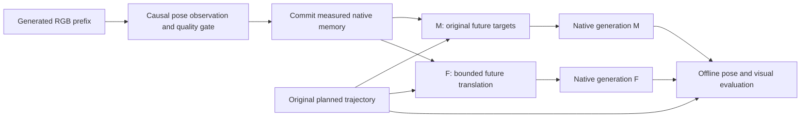

# Bounded continuation after measured-memory writes

Status: completed development ablation: eight generations, four paired VIPE
scores, and sixteen post-hoc DA3 checks. All generation and scoring jobs passed.
The policy is not promoted: suppressing return motion increased position error
in every pair. This does not refute measured-memory correction.
The implementation is `camera_loop.memory_rate.bounded_memory_continuation`.
It is a separate experimental API, not the default `CorrectionSession` policy.

Interpretation update: this F arm has a structural tracking disadvantage. At
constant nominal speed equal to the plan maximum, its cap supplies no catch-up
headroom unless incoming motion is already faster. Its nonnegative halfspace
forbids a return toward an overshot target. The four observed losses therefore
cannot diagnose generator resistance to corrective commands. This is not a
universal theorem about arbitrary generators or varying-speed plans: the cap
can leave headroom below the global plan maximum. The next
[fractional-recovery experiment](fractional_recovery_20261103.md) explicitly
requests part of the residual, supplies speed headroom and allows return.

## Question and matched intervention

The memory-component experiments found that correcting history labels can
improve position error while continuation returns toward an overshot target.
That return can be useful correction; one boundary establishes neither
instability nor stability. This pilot asks what happens when future translation
is constrained after the same measured memory write. Its non-reversal objective
is an ablation, not the definition of successful tracking. It does not fit a
generator response gain. See the [framing correction](framing_review_20261103.md).

For each model, scene and seed:

| Arm | Committed history | Future camera targets |
| --- | --- | --- |
| M | Accepted measured poses | Original plan |
| F | Exactly the same measured poses | Bounded translation continuation; original rotations |

Both arms regenerate the prefix. Exact prefix RGB, intrinsics, anchor depth and
measurement frame IDs bind a shared causal observation. A mismatch invalidates
the pair. Geometry calibration is fresh for each case and shared only within
its pair. Original evaluation targets remain fixed. There is no fresh native
baseline in this experiment, so F-versus-M results cannot by themselves establish
improvement over the unmodified generator.



The initial geometry calibration precedes both branches. Offline evaluation
does not feed back into either generation. Rejected memory observations leave
future conditioning unchanged.

## Geometry and memory prerequisites

The controller accepts camera-to-world poses already expressed in one supported
native geometry gauge. It cannot infer this gauge from a command/execution
ratio: under-execution is not a unit conversion. No future reference RGB or
trajectory-motion fit is used for calibration or feedback.

SANA uses its released metric-sidecar camera contract and the initial anchor's
estimated metric depth conversion. Its native camera encoder preserves
translation amplitude. The observer uses matching processed intrinsics and
depth. Native clean-cache replay commits the measured history labels while the
image-only refiner memory is retained. F then changes only future ray and
Plücker inputs. The metric anchor is an estimate, not physical ground truth.

Lyra registers its initial native depth, after native optional MoGe alignment,
to corresponding resized reference anchor pixels. The resulting positive scale
is applied once to camera translations and observer depth. The memory write
updates dense history cameras and reconstructs cached world points using retained
depth and intrinsics. F starts from the actually stored, quantized history pose.
Its native world-to-camera rotation entries remain bitwise unchanged.

The pilot does not test LingBot's revised joint normalization or DreamX's
future-only actuator. Astronex/WorldPlay units, WorldWarp continuation geometry,
and MatrixGame's causal block-decoding seam remain separate qualifications.
Their earlier results and limitations remain in the
[cross-model memory audit](memory_components_20261102.md).

## Translation policy

Let `b` be the emitted boundary, `p_i` the original planned camera center,
`m_b` the committed measured center, `d` the adapter's native camera interval in
RGB frames, and `H` the remaining chunk duration. Estimate incoming velocity
over the most recent available measured interval of at least `d` frames:

```text
v_b = (m_b - m_j) / (b - j),       j <= b - d
V   = max(max_i ||p_i - p_(i-1)||, ||v_b||)
A   = V / d
x_b = m_b
```

For each remaining RGB frame, form the desired velocity using the current
predicted position. `H` is fixed to the remaining duration at the boundary;
the residual is recomputed rather than accumulated again:

```text
t_i = p_i - p_(i-1)
w_i = t_i + (p_i - (x_(i-1) + t_i)) / H
```

Project `w_i` onto the nonnegative halfspace along the planned chunk's net
translation direction, then cap its norm to `V`. Move from the preceding
velocity toward that vector by at most `A`, and integrate the resulting velocity
to obtain `x_i`. If this bounded transition cannot preserve nonnegative forward
projection, abstain from the entire future correction and retain the original
future commands. This is failure of this candidate policy, not a proof that the
generator is uncontrollable.

The forward constraint is scoped to chunks whose planned native-interval
displacements are forward-monotone along their net direction. Intentional
reversals and loops are outside this pilot. Exact identity history produces an
exact no-op. The policy preserves all past command records and future rotation
targets. It reports remaining endpoint lag rather than forcing an endpoint
rejoin. A command log retains its previously issued boundary entry; continuity
is assessed from the committed measured boundary, which is the generator's new
memory coordinate.

Preserving original future rotations can retain an angular discontinuity relative
to the measured history. This translation-only pilot does not bound that jump;
the post-hoc report records it. Equal rotation targets also do not imply equal
generated rotation, since translation and rotation conditioning can interact.

`V` scales with plan and measured motion. `A=V/d` is a structural stopping-time
choice, not an online learned optimum. Incoming speed can itself be noisy or
excessive, so this ceiling does not establish physical safety. The policy is
invariant to a common positive unit rescaling. Neither that property nor its
command constraints guarantees the speed, acceleration or direction of generated
motion. There is no noise-calibrated deadband, differential-gain estimator,
inverse-response controller, or new scene-loss detector in this module. Existing
observer acceptance remains a prerequisite and a separate source of uncertainty.

The constraints above apply before native tensor quantization. A planned zero
forward component can become slightly negative when SANA rounds its camera
conditions to bf16. The post-hoc native check reproduces actual ray/Plücker
hashes and separately reports sampled camera-center rounding errors. Forward
and speed bounds at those sampled poses are checked with allowances derived
from those errors; exact nonnegative native projection is not assumed.

Unchanged future target numbers do not imply unchanged relative motion after a
memory write. In M, the first future target can lie far behind the newly stored
measured boundary. This creates a large relative return command even though the
future target array was not edited. F removes that immediate return by starting
from the committed boundary and limiting subsequent increments.

There is a corresponding feasibility limit. For forward direction `q`, a
non-reversing command path has `q dot x_end >= q dot m_b`. Its endpoint error
against a fixed target therefore satisfies
`||x_end - p_end|| >= max(0, q dot (m_b - p_end))`.
If the boundary has already passed the final target, eliminating commanded
backtracking necessarily retains some tracking error. This is a geometric
command-path bound under the assumed measurement, not a bound on the generator's
actual motion. Retiming evaluation would change the objective and is not used.

## Frozen development protocol

Local root: `analysis/memory_rate_20261102/`.
Manifest SHA256:
`4bb5e64c458a27c4eca43599943c10f10bece6768e16fcc7abb7b9033a3433b7`.

| Model | Scene | Seeds | RGB frames | Boundary | Native interval |
| --- | --- | --- | --- | --- | --- |
| SANA | 02267acf | 7, 107 | 49 | 24 | 8 |
| Lyra | 02267acf | 7, 107 | 161 | 80 | 4 |

Eight fresh generations and four paired scoring jobs run serially with shared
GPU locks, a 4 GiB disk launch reserve, a 2 GiB runtime reserve and a 2 GiB host
memory reserve. Source hashes are checked before every job. Rejections, failures
and abstentions are retained. Frozen sources are not edited during execution.

Before generation, seven controller tests passed, both native overlays compiled,
the actual SANA encoder preserved prior conditioning and encoded the new future,
and the actual Lyra trajectory loader passed unit/intrinsics checks. The seven
tests cover overshoot, scale equivariance, identity, reversed incoming motion,
rotation/past preservation, intended target reversals and future-observation
rejection.

The direction constraint was revised during pre-freeze CPU development: using
each small RGB target step made all candidates abstain. The frozen policy uses
the chunk's net direction and requires forward-monotone native intervals. This
scene and these seeds are development data, not held-out validation. No generated
outcomes were available when this protocol was frozen.

## Required outcome checks

For each pair, report whether memory was accepted and whether F actually changed
the native future inputs. Verify identical memory and prefixes, preserved past
commands and rotations, and scale provenance. Evaluate both outputs against the
same original trajectory using fixed-anchor VIPE registration. Report position
and rotation errors, net projected progress, trajectory shape and visual
artifacts together. Backward projected progress is observer-derived evidence,
not automatically an independent physical ground-truth measurement.

One boundary on one development scene can reveal a useful effect or a failure.
It cannot establish multi-boundary stability, recovery from intentional turns,
cross-scene generalization, or an identifiable causal response gain. Those need
separate frozen experiments after this pilot's attribution checks pass.

## Completed results and interpretation

All pairs have exact shared RGB prefixes and identical accepted measured-memory
writes. Native future input hashes were reproduced from the recorded commands;
only F changes future translation. Native unit conversions match the declared
anchor mapping (exact in SANA, float32 roundoff in Lyra). Sampled RGB retains
recognizable scenes in all eight runs. These are not fresh native-baseline
comparisons or full-video quality certification.

| Model / seed | Mean position M → F | Mean rotation M → F (°) | VIPE net projected progress M → F |
| --- | --- | --- | --- |
| SANA / 7 | 0.00994 → 0.01211 | 0.366 → 0.488 | −0.00538 → −0.00029 |
| SANA / 107 | 0.00873 → 0.01192 | 0.419 → 0.582 | +0.00062 → +0.00460 |
| Lyra / 7 | 0.01839 → 0.01988 | 0.0765 → 0.0668 | +0.15341 → +0.15408 |
| Lyra / 107 | 0.01258 → 0.01398 | 0.0788 → 0.0698 | +0.14045 → +0.14183 |

Position and progress use reference anchor-depth units. Horizons differ by
model; do not pool these raw errors into one cross-model effect. Lyra's roughly
0.009–0.010° angular reductions are small absolute changes, not established
meaningful gains. This scene is near-stationary over SANA's short window; its
161-frame Lyra window includes appreciable later target motion.

The original M future target implies a first relative translation step about
45/36 times the plan's maximum RGB step in SANA, versus 1.71/1.50 in F. Lyra's
corresponding ratios are 2.45/2.22 versus 0.225/0.226. These are command-path
diagnostics, not observed velocity gains. A faithful return can reduce target
error despite this discontinuity, so these ratios do not themselves define
failure. SANA's measured boundaries already exceed its final target projection;
the no-return policy necessarily retains a command endpoint error of at least
0.00925/0.00561 in that direction. Rotation targets were not smoothed.

DA3 supports the overall reduction in return motion but does not certify that F
is reversal-free. For SANA seed 7 its continuation progress is −0.00820 (M) and
−0.00311 (F); VIPE estimates a smaller remaining return. SANA seed 107 M has an
uncertain net sign: DA3 −0.00145 versus VIPE +0.00062. At the first native
interval, both observers see a return for M in all four pairs. Both see forward
F motion for Lyra; SANA's small F components remain observer/direction dependent.
The report retains both local planned-interval and fixed chunk-axis projections.
These post-hoc checks are not calibrated confidence intervals.

**Decision:** retain this policy as a documented objective/continuity ablation.
Its higher fixed-target error is not evidence against SANA's stronger moving-
scene measured-memory results. The next study uses 0238de14 and model-appropriate
actuators, followed by a multi-boundary test; it does not enforce no return as
the universal success criterion.

The final repository suite passes **115 tests**. After all frozen jobs finished,
one API-only validation bug was repaired: decreasing unsigned frame IDs now
raise an error instead of passing because integer subtraction wrapped. The
GPU inputs were ordered signed IDs, so their behavior is unchanged. Exact pilot
source/test snapshots and before/after hashes are retained separately.

See [machine-readable evidence](memory_rate_evidence_20261102.json), the
[visual gallery and trajectory figures](memory_rate_gallery_20261102.md), and
[frozen source excerpts](artifacts/memory_rate_20261102/README.md).
