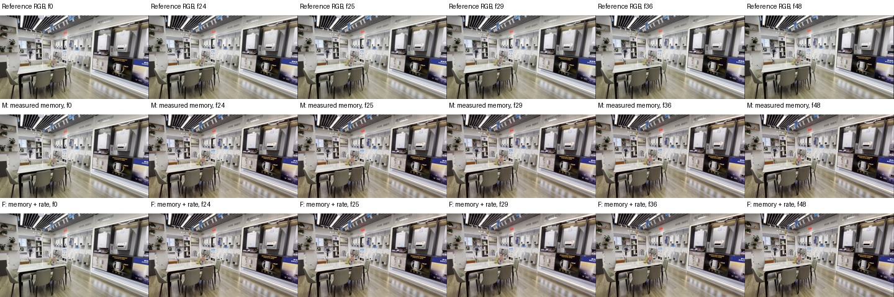
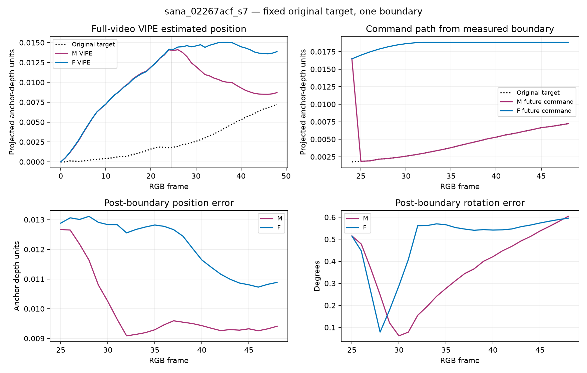
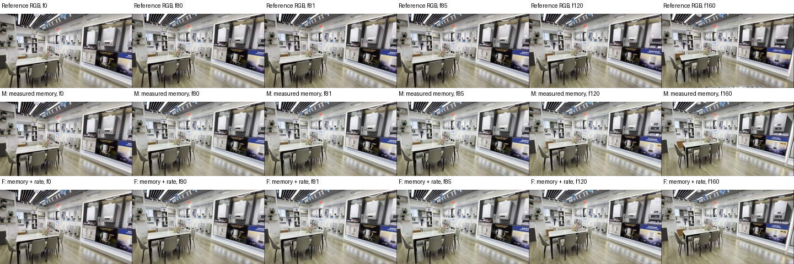
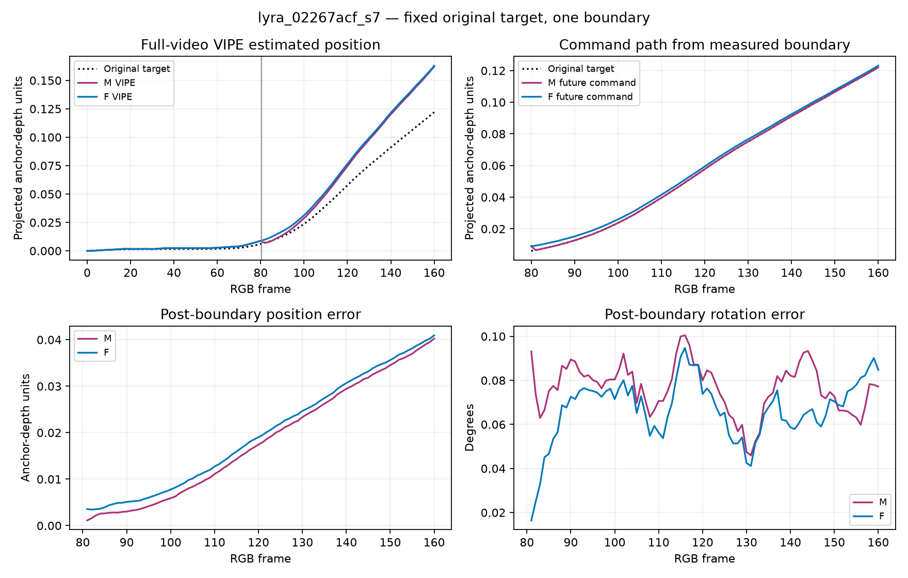
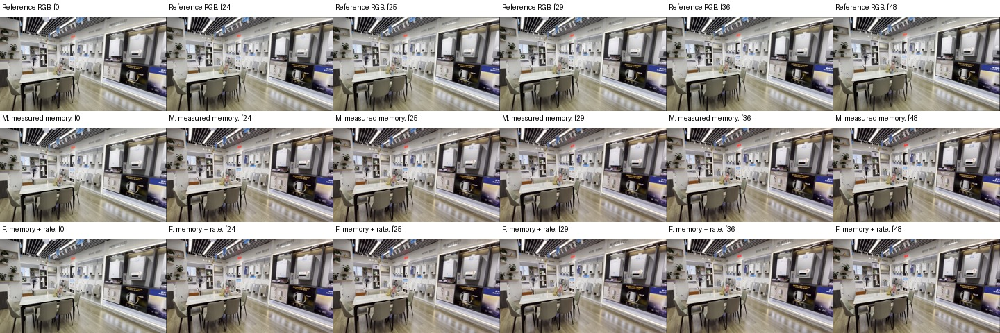
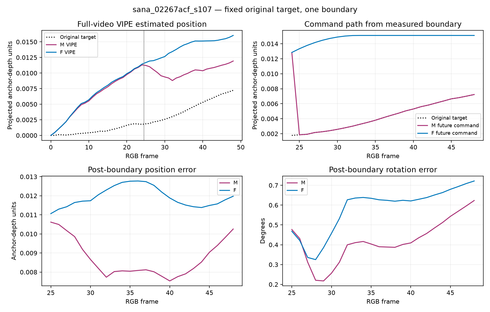
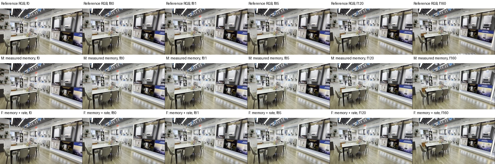
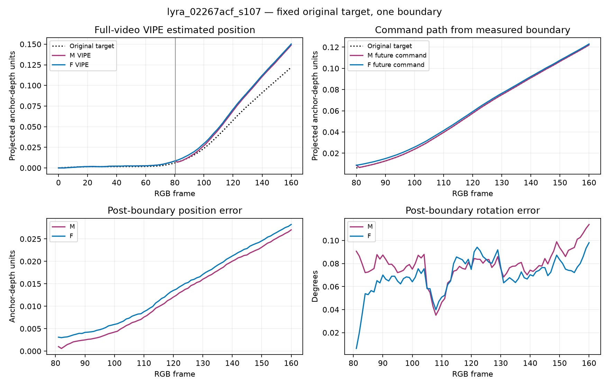

# Measured memory with bounded continuation: visual evidence

Reference RGB, fixed-target pose errors, and command paths are shown together. All pairs share one development scene (02267acf). The reference recording is not independent dense metric pose ground truth.

## sana — seed 7

[Download trajectory figure (PDF)](assets/memory_rate_20261102/sana_02267acf_s7_trajectories.pdf)

VIPE shows sustained backward projected motion for M. F remains near its overshot boundary position and has a later backward drift; it does not prove reversal-free generated motion. F has worse average position and rotation error against the fixed target.

## lyra — seed 7

[Download trajectory figure (PDF)](assets/memory_rate_20261102/lyra_02267acf_s7_trajectories.pdf)

VIPE estimates a short backward interval immediately after the M boundary; F has positive progress at every sampled native interval. Both subsequently overtravel the original target. F increases average position error while slightly lowering average rotation error.

## sana — seed 107

[Download trajectory figure (PDF)](assets/memory_rate_20261102/sana_02267acf_s107_trajectories.pdf)

VIPE estimates an initial backward interval for M followed by forward motion. F is forward at all sampled native intervals, but stays farther beyond the fixed target and has higher average position and rotation error. A positive net displacement alone would hide M's initial backward interval.

## lyra — seed 107

[Download trajectory figure (PDF)](assets/memory_rate_20261102/lyra_02267acf_s107_trajectories.pdf)

The short estimated M boundary return is absent in F at native sample intervals. Both arms then overtravel the target. F has higher average position error and a small absolute reduction in rotation error. Returning toward an overshot target is not itself a failure; this one-boundary test cannot establish oscillation.
