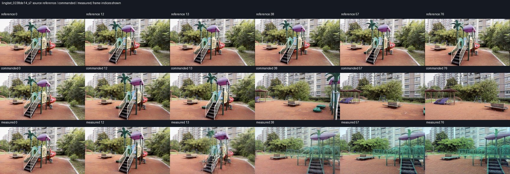
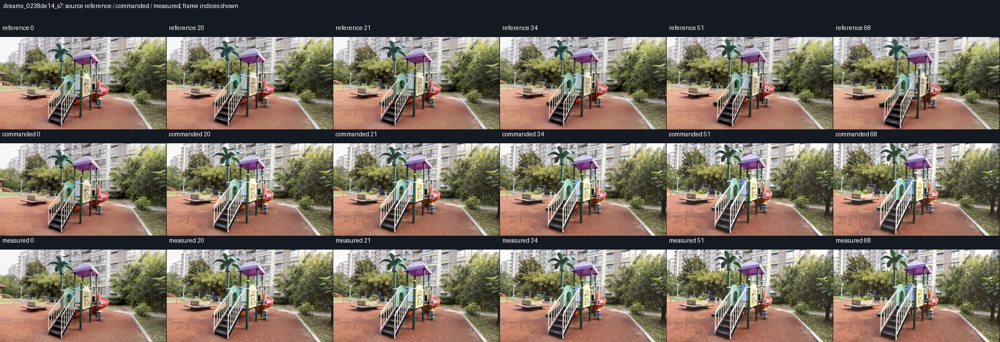
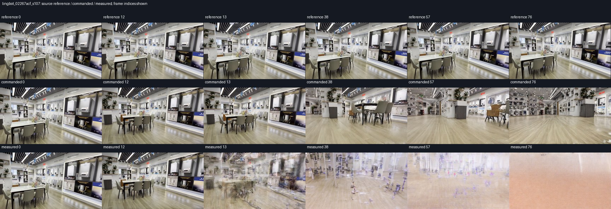
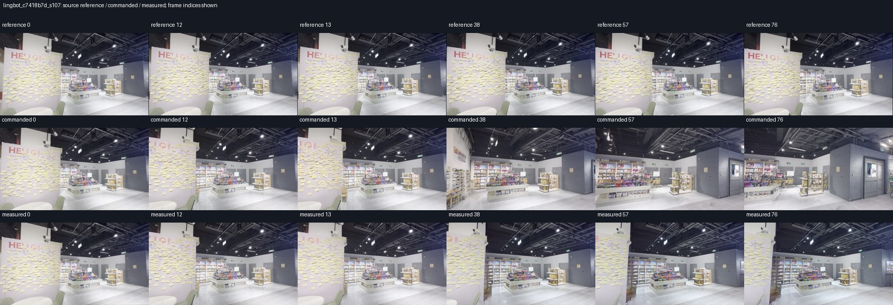
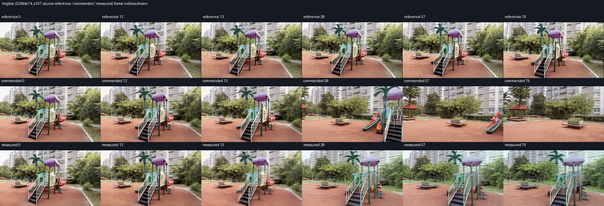
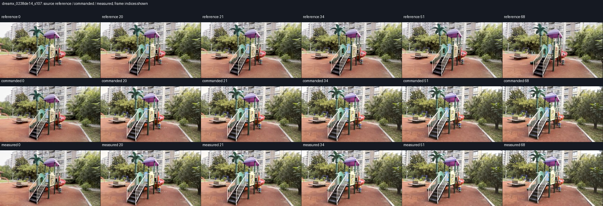

# Repeated-memory visual and reference-motion audit

This is a development-cohort audit, not new aggregate efficacy evidence. All
40 planned pairs remain in the evaluation. The source RGB frames are the
reference video; stored camera poses may be VIPE-derived and are not claimed
as independent ground truth. Translation is in each scene's reference
anchor-depth units, not established metric metres.

Latest reviewed snapshot: **16/40 original pairs**, eight LingBot and eight DreamX.
Twelve have valid positional registration; four are zero-write abstentions with
unavailable position metrics. Three reviewed LingBot pairs have visible scene
fidelity failures despite lower position-error scores; the additional moving-scene
seed-107 pair has boundary ghosting and structural changes with recognizable
later content. The sections below retain
earlier snapshots as dated progression; their counts are not the latest coverage.
The full-horizon SANA, MatrixGame and Lyra resource retries remain separate and
do not erase their original execution failures.

## Motion depends on the evaluated horizon

The following net displacements come directly from the frozen target arrays.
No generated outcome is used to select scenes or change the protocol. Native
horizons differ, so these are context values rather than comparable model scores.

| Scene | LingBot 77 frames | SANA 121 | DreamX 69 | MatrixGame 337 | Lyra 321 |
| --- | ---: | ---: | ---: | ---: | ---: |
| 02267acf | 0.01338 | 0.05817 | 0.01171 | 0.41388 | 0.39613 |
| c7418b7d | 0.07928 | 0.11399 | 0.07086 | 0.45868 | 0.42950 |
| 0238de14 | 0.10162 | 0.17905 | 0.09005 | 0.62680 | 0.59390 |
| 924228bf | 0.00861 | 0.01330 | 0.00757 | 0.04556 | 0.04339 |

`02267acf` is nearly stationary over the short LingBot/DreamX intervals, but
moves substantially later in the long MatrixGame/Lyra intervals. A scene-level
"stationary" label would therefore misdescribe some experiments. `924228bf`
has relatively little translation throughout these windows. The full audit
includes path length, step statistics and angular path length for all 20
scene/horizon combinations. These are descriptive values, not new inclusion
thresholds; no case is removed.

## LingBot 02267acf, seed 7: confirmed visual failure

Direct inspection covers frames 0, 12, 13, 38, 57 and 76. The reference changes
little. The commanded output retains recognizable store content while drifting
strongly toward the floor. The measured output shares the sampled prefix but
shows severe overlapping and fragmented geometry already at frame 13, and the
distortion persists through the later samples. Its 74.24% reduction in mean
position error is therefore **not a successful visual-control result**. This
pair remains a policy failure in the cohort; it is not excluded from reporting.

This is sampled inspection, not a full-video review, and it cannot characterize
oscillation between the sampled frames. Thumbnails preserve native framing
rather than claiming pixel-aligned reference/output correspondence.

The [manifest](artifacts/generalization_20261103/visual_review/manifest.json)
binds score files, lossless RGB archives, reference images and sheets by SHA256.
The [inspection record](artifacts/generalization_20261103/visual_review/lingbot_02267acf_s7.review.json)
records the scope of the human-readable observations. The generator queue and
its frozen scientific sources were not changed by this audit. Additional
completed pairs still require their own visual reviews.

## Observer validity does not establish scene fidelity

The [memory-event audit](artifacts/generalization_20261103/visual_review/lingbot_gate_audit.json)
shows that all four writes passed the existing quality gate. After the visible
failure, the write covering frames 12–28 contains a **138.74° adjacent stored
rotation jump**; its anchor-depth p90/p10 ratio is still 1.084, comfortably
inside the existing limit of 4. Subsequent writes also pass.

This is direct evidence that the present proper-SE(3) and anchor-registration
checks do not detect this visual failure. The jump inferred from collapsed RGB
is not evidence of a physical camera reversal. It also occurs after the first
visible failure, so it does not by itself identify that initial failure's cause.
The deployed v1 gate is not a validated collapse detector, as the frozen protocol
already states. A future image-consistency gate would need separate validation;
no new threshold or scene-specific exception is inserted into this cohort.

## DreamX 02267acf, seed 7: small change after four writes

The first completed 69-frame DreamX pair has exact raw pre-intervention equality,
four accepted writes and valid positional registration in both arms. Post-boundary
mean position error is 0.038172 → 0.037501 reference anchor units (−1.76%); mean
rotation error is 0.824285° → 0.809984° (−0.01430°). These are descriptive paired
numbers from one scene and seed, not a general efficacy estimate.

Frames 0, 20, 21, 34, 51 and 68 retain recognizable store geometry in both arms.
Both drift relative to the near-stationary reference, and the two generated rows
look very similar. Severe collapse is not evident in these six samples; this is
not a full-video quality or oscillation assessment. Exact lossless decoding gives
post-boundary mean RGB absolute difference **1.0853/255**, with zero difference
through the pre-intervention prefix. No matched regeneration noise floor was
measured here, so this small difference is not evidence of a reliable differential
gain or statistically established control benefit.

[Score](artifacts/generalization_20261103/visual_review/dreamx_02267acf_s7.score.json),
[visual inspection](artifacts/generalization_20261103/visual_review/dreamx_02267acf_s7.review.json),
and [frame-wise RGB differences](artifacts/generalization_20261103/visual_review/dreamx_02267acf_s7.rgb_difference.json)
retain the numerical and visual evidence. MatrixGame was running next at this
snapshot; SANA remained an execution failure with a separate resource retry queued.

## c7418b7d, seed 7: two additional completed pairs

LingBot's 77-frame pair has exact pre-intervention RGB equality and four
accepted writes. Mean position error falls **0.659398 → 0.128310 (80.54%)**,
while mean rotation error rises **1.90072° → 4.35909°**. At sampled frames
0, 12, 13, 38, 57 and 76, the measured arm retains recognizable shop geometry
and stays closer to the reference composition than the strongly drifting
commanded arm. The severe fragmentation of the `02267acf` case is not evident
here. This supports a positional benefit with a rotation tradeoff on this pair;
it does not establish aggregate efficacy or exclude temporal defects between
samples. The earlier collapsed pair remains in the denominator.

DreamX's 69-frame pair has exact pre-intervention equality. Mean position error
rises **0.033154 → 0.033859 (2.13%)**, and mean rotation error rises
**1.90717° → 1.93598°**. Both generated rows look very similar at frames
0, 20, 21, 34, 51 and 68, retain recognizable geometry, and diverge in framing
from the reference later in the clip. No severe collapse is evident in these
samples. This is a small numerical regression, without a measured regeneration
floor or a differential-authority conclusion.

The manifest links the score and inspection hashes for both new pairs. At this
snapshot **4/40 original pairs** are scored. SANA, MatrixGame and Lyra each
stopped at a host-memory guard; those are execution failures with missing paired
evidence. Full-horizon SANA and Matrix resource retries are queued. Lyra still
requires resource-path diagnosis. Model-specific horizons and all original cases
remain fixed in the [coverage ledger](generalization_coverage_20261103.json).

## LingBot 0238de14, seed 7: moving-scene fidelity failure

The next 77-frame pair has exact prefix equality and four accepted writes.
Mean position error falls **0.617993 → 0.302626 (51.03%)**, and mean rotation
error falls **4.53203° → 2.97007°**. Yet the sampled measured output has strongly
overlapping/ghosted stairs and poles at frame 13. Later samples show a
substantially changed play structure and roof, with appearance changes relative
to the source. The commanded arm drifts far past the central structure.

This is a **scene-fidelity failure despite improved pose metrics**, retained in
the cohort. It shows that the visual failure is not confined to the nearly
stationary `02267acf` scene. It does not identify the encoder denominator as the
cause or establish a physical reversal from estimated poses. The shorter prior
moving-scene results do not substitute for this repeated-write evidence.

Five original pairs have scores at this subsequent snapshot. Lyra now has a
[full 321-frame resource retry](lyra_observer_resources_20261103.md) queued;
the original failure remains recorded and GPU qualification is pending.

## DreamX 0238de14, seed 7: small mixed changes

The sixth scored pair has an exact prefix and four accepted writes. Mean
position error changes **0.017469 → 0.017767 (1.71% worse)**, endpoint position
**0.031227 → 0.030699**, and mean rotation **1.02951° → 0.98635°**. Sampled
frames 0, 20, 21, 34, 51 and 68 retain recognizable playground geometry in
both arms, with very similar appearance. Severe fragmentation like the LingBot
case is not evident. These small mixed differences have no matched regeneration
floor; they do not establish efficacy or differential memory authority.

At this snapshot, six of the original 40 pairs have been scored and reviewed
at six timestamps each. This remains an incomplete development cohort.

## Second seed: a repeated failure and a repeated positional benefit

Four more active-write pairs have exact pre-intervention prefixes and four
accepted writes each. Values below are post-intervention means, in anchor-depth
units for position and degrees for rotation. These are paired descriptive results,
not seed-level significance tests or an aggregate success claim.

| Model / scene / seed | Position commanded → measured | Position reduction | Rotation commanded → measured | Sampled visual assessment |
| --- | ---: | ---: | ---: | --- |
| LingBot / 02267acf / 107 | 0.653030 → 0.527340 | 19.25% | 9.44113 → 10.06880 | Severe collapse |
| LingBot / c7418b7d / 107 | 0.672543 → 0.160014 | 76.21% | 1.70666 → 1.82583 | Recognizable shop; rotation tradeoff |
| DreamX / 02267acf / 107 | 0.032730 → 0.033242 | −1.56% | 0.64382 → 0.62727 | Similar appearance; small mixed changes |
| DreamX / c7418b7d / 107 | 0.038726 → 0.038395 | 0.86% | 2.63300 → 2.70716 | Similar appearance; small mixed changes |

LingBot's `02267acf` measured arm is severely ghosted at frame 13, deteriorates
further at frames 38 and 57, and ends largely featureless at frame 76. The
commanded arm drifts but retains recognizable store structure. Thus the visual
failure repeats across both seeds on this scene; a positive pose-score reduction
cannot be counted as a successful visual-control outcome.

On `c7418b7d`, the measured samples retain the note-covered partition and shelf
layout closer to reference framing, while the commanded arm drifts across the
shop. This repeats the seed-7 positional benefit with recognizable sampled
geometry. Rotation remains a tradeoff: endpoint rotation is **1.91729° →
4.09762°**, larger than the mean change suggests. Two seeds establish recurrence
in these tested cases, not statistical generalization across scenes or seeds.

Both new DreamX pairs retain similar recognizable geometry at the six sampled
timestamps. The position-effect signs reverse relative to seed 7 on both scenes:
`02267acf` changes from a small improvement to a small regression, and `c7418b7d`
from a small regression to a small improvement. There is no matched regeneration
floor here. These results do not establish reliable memory-channel benefit or a
differential command gain.

## Zero-write cases: full RGB equality verified

LingBot and DreamX on `924228bf`, seed 7, accepted **zero** memory writes.
All **77 LingBot frames** and **69 DreamX frames** were decoded at native
resolution as RGB24 and compared by per-frame SHA256, dimensions and timestamps.
The two arms are exactly equal throughout each clip. This is stronger evidence
of unchanged fallback behavior than matching pose scores or six thumbnails.

Both observers reject scalar anchor-depth registration for the final position
assessment. Position metrics remain **unavailable**, not zero. Rotation means
are identical between arms (LingBot 1.54615°, DreamX 3.97277°), as expected from
identical RGB. Samples retain recognizable building/tree geometry but drift in
viewpoint relative to the reference. These cases remain in the cohort as
abstentions, without a correction-benefit claim.

The [LingBot RGB audit](artifacts/generalization_20261103/visual_review/lingbot_924228bf_s7.abstention_rgb.json)
and [DreamX RGB audit](artifacts/generalization_20261103/visual_review/dreamx_924228bf_s7.abstention_rgb.json)
record every decoded frame digest and the reproducible audit script hash.

## Consequence for the next experiments

The frozen method and original 40-pair denominator stay unchanged. A general
method can have scene failures; the eventual claim depends on the aggregate
pose/quality tradeoff, intervention coverage, abstentions and execution coverage.
Pose improvements on collapsed videos must remain visible alongside their scores.

The repeated scene dependence supports finishing the queued
[matched normalization diagnostic](lingbot_gauge_pilot_20261103.md), which separates
shared rescaling from measured labels. It does not prove normalization is the
cause or justify adding a scene-specific exception. DreamX's sign-changing small
memory effects support the separate [future-command pilot](dreamx_future_command_20261103.md),
whose first feedback command remains nominal and whose later commands respond
to observed lag. Neither queued ablation is evidence of efficacy before its
parity gates and matched runs complete. Six-frame reviews also do not resolve
zigzag motion between samples.

## Moving scene, seed 107: pose benefit with visible fidelity tradeoffs

LingBot `0238de14`, seed 107, completes all 77 frames, has an exact
pre-intervention prefix and accepts four writes. Mean position error is
**0.543381 → 0.154948 (71.48% lower)** and mean rotation error is
**3.90866° → 2.52908°**. Endpoint position is 0.961401 → 0.166888;
endpoint rotation is 7.53677° → 2.59558°.

The commanded arm drifts far past the playground. The measured arm has ghosted
stair/pole edges at the first corrected boundary, followed by recognizable
playground content with changed roof and rail geometry. The commanded arm also
changes structure while drifting. This is a pose benefit with visible quality
tradeoffs, not a clean visual-control success. It is also not the sustained
near-total content loss of `02267acf`, seed 107.

In addition to the six matched reference samples, both generated arms were
inspected at **every frame** as 160×88 thumbnails:
[commanded](artifacts/generalization_20261103/visual_review/lingbot_0238de14_s107.commanded.all_frames.jpg),
[measured](artifacts/generalization_20261103/visual_review/lingbot_0238de14_s107.measured.all_frames.jpg).
The [manifest](artifacts/generalization_20261103/visual_review/lingbot_0238de14_s107.all_frames.json)
binds the full-frame sheets to the lossless archives. Static thumbnails still
do not establish physical camera reversal, perceptual video quality, or absence
of fine artifacts. The failure mode therefore repeats qualitatively at the first
boundary across the two moving-scene seeds, with different severity and later
appearance; it is not reduced to a binary scene-level collapse label.

## DreamX moving scene, seed 107: another small mixed change

The 69-frame pair has exact prefix equality and four accepted writes. Mean
position error is **0.024619 → 0.024667 (0.20% worse)**, endpoint position
0.044552 → 0.044427, and mean rotation **1.79088° → 1.80228°**. The six
matched samples retain recognizable playground geometry and look very similar
between arms, without evident severe fragmentation. No matched regeneration
floor was measured; these small changes do not establish reliable efficacy or
differential memory authority. This brings sampled reviews to 14 original pairs.

## Final original LingBot/DreamX cases: seed-107 abstentions

Both `924228bf`, seed-107 pairs accept zero writes. All 77 LingBot RGB frames
and all 69 DreamX RGB frames are exactly equal between their arms, verified by
native-resolution per-frame SHA256 after lossless decoding. Position is
unregistered in both arms. Mean rotation is identical within each pair:
LingBot **1.92571°**, DreamX **3.40498°**. Six-frame inspection shows recognizable
building/tree geometry with viewpoint drift relative to the reference and no
visible difference between the arms.

[LingBot equality receipt](artifacts/generalization_20261103/visual_review/lingbot_924228bf_s107.abstention_rgb.json),
[DreamX equality receipt](artifacts/generalization_20261103/visual_review/dreamx_924228bf_s107.abstention_rgb.json),
[LingBot sheet](artifacts/generalization_20261103/visual_review/lingbot_924228bf_s107.jpg),
and [DreamX sheet](artifacts/generalization_20261103/visual_review/dreamx_924228bf_s107.jpg)
complete the original two-model evidence. These are abstentions with missing
position metrics, not successful active corrections. The
[40-case accounting](primary_cohort_accounting_20261103.md) retains all original
resource failures/holds while full-horizon retries proceed separately.
