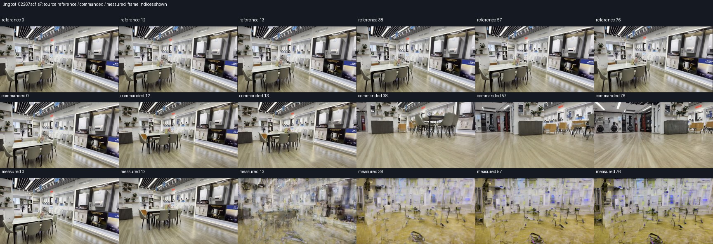
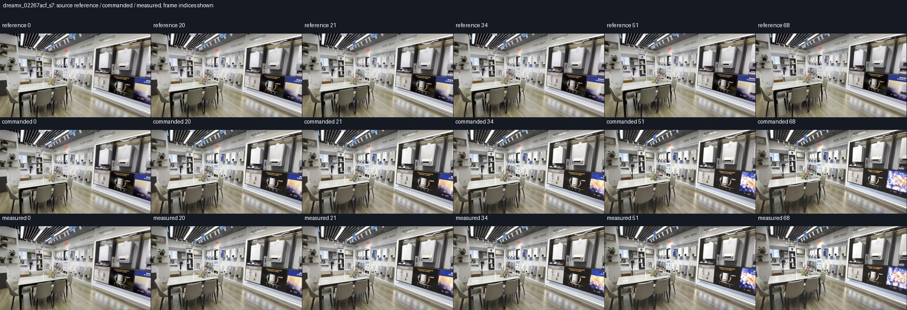
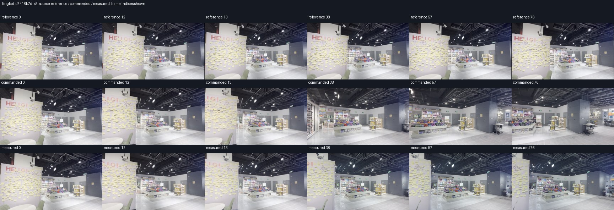
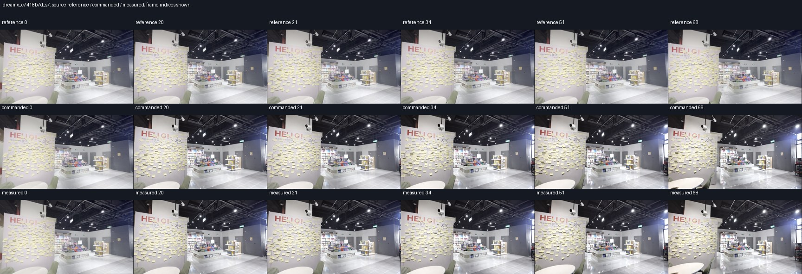

# Repeated-memory visual and reference-motion audit

This is a development-cohort audit, not new aggregate efficacy evidence. All
40 planned pairs remain in the evaluation. The source RGB frames are the
reference video; stored camera poses may be VIPE-derived and are not claimed
as independent ground truth. Translation is in each scene's reference
anchor-depth units, not established metric metres.

## Motion depends on the evaluated horizon

The following net displacements come directly from the frozen target arrays.
No generated outcome is used to select scenes or change the protocol. Native
horizons differ, so these are context values rather than comparable model scores.

| Scene | LingBot 77 frames | SANA 121 | DreamX 69 | MatrixGame 337 | Lyra 321 |
| --- | ---: | ---: | ---: | ---: | ---: |
| 02267acf | 0.01338 | 0.05817 | 0.01171 | 0.41388 | 0.39613 |
| c7418b7d | 0.07928 | 0.11399 | 0.07086 | 0.45868 | 0.42950 |
| 0238de14 | 0.10162 | 0.17905 | 0.09005 | 0.62680 | 0.59390 |
| 924228bf | 0.00861 | 0.01330 | 0.00757 | 0.04556 | 0.04339 |

`02267acf` is nearly stationary over the short LingBot/DreamX intervals, but
moves substantially later in the long MatrixGame/Lyra intervals. A scene-level
"stationary" label would therefore misdescribe some experiments. `924228bf`
has relatively little translation throughout these windows. The full audit
includes path length, step statistics and angular path length for all 20
scene/horizon combinations. These are descriptive values, not new inclusion
thresholds; no case is removed.

## LingBot 02267acf, seed 7: confirmed visual failure

Direct inspection covers frames 0, 12, 13, 38, 57 and 76. The reference changes
little. The commanded output retains recognizable store content while drifting
strongly toward the floor. The measured output shares the sampled prefix but
shows severe overlapping and fragmented geometry already at frame 13, and the
distortion persists through the later samples. Its 74.24% reduction in mean
position error is therefore **not a successful visual-control result**. This
pair remains a policy failure in the cohort; it is not excluded from reporting.

This is sampled inspection, not a full-video review, and it cannot characterize
oscillation between the sampled frames. Thumbnails preserve native framing
rather than claiming pixel-aligned reference/output correspondence.

The [manifest](artifacts/generalization_20261103/visual_review/manifest.json)
binds score files, lossless RGB archives, reference images and sheets by SHA256.
The [inspection record](artifacts/generalization_20261103/visual_review/lingbot_02267acf_s7.review.json)
records the scope of the human-readable observations. The generator queue and
its frozen scientific sources were not changed by this audit. Additional
completed pairs still require their own visual reviews.

## Observer validity does not establish scene fidelity

The [memory-event audit](artifacts/generalization_20261103/visual_review/lingbot_gate_audit.json)
shows that all four writes passed the existing quality gate. After the visible
failure, the write covering frames 12–28 contains a **138.74° adjacent stored
rotation jump**; its anchor-depth p90/p10 ratio is still 1.084, comfortably
inside the existing limit of 4. Subsequent writes also pass.

This is direct evidence that the present proper-SE(3) and anchor-registration
checks do not detect this visual failure. The jump inferred from collapsed RGB
is not evidence of a physical camera reversal. It also occurs after the first
visible failure, so it does not by itself identify that initial failure's cause.
The deployed v1 gate is not a validated collapse detector, as the frozen protocol
already states. A future image-consistency gate would need separate validation;
no new threshold or scene-specific exception is inserted into this cohort.

## DreamX 02267acf, seed 7: small change after four writes

The first completed 69-frame DreamX pair has exact raw pre-intervention equality,
four accepted writes and valid positional registration in both arms. Post-boundary
mean position error is 0.038172 → 0.037501 reference anchor units (−1.76%); mean
rotation error is 0.824285° → 0.809984° (−0.01430°). These are descriptive paired
numbers from one scene and seed, not a general efficacy estimate.

Frames 0, 20, 21, 34, 51 and 68 retain recognizable store geometry in both arms.
Both drift relative to the near-stationary reference, and the two generated rows
look very similar. Severe collapse is not evident in these six samples; this is
not a full-video quality or oscillation assessment. Exact lossless decoding gives
post-boundary mean RGB absolute difference **1.0853/255**, with zero difference
through the pre-intervention prefix. No matched regeneration noise floor was
measured here, so this small difference is not evidence of a reliable differential
gain or statistically established control benefit.

[Score](artifacts/generalization_20261103/visual_review/dreamx_02267acf_s7.score.json),
[visual inspection](artifacts/generalization_20261103/visual_review/dreamx_02267acf_s7.review.json),
and [frame-wise RGB differences](artifacts/generalization_20261103/visual_review/dreamx_02267acf_s7.rgb_difference.json)
retain the numerical and visual evidence. MatrixGame was running next at this
snapshot; SANA remained an execution failure with a separate resource retry queued.

## c7418b7d, seed 7: two additional completed pairs

LingBot's 77-frame pair has exact pre-intervention RGB equality and four
accepted writes. Mean position error falls **0.659398 → 0.128310 (80.54%)**,
while mean rotation error rises **1.90072° → 4.35909°**. At sampled frames
0, 12, 13, 38, 57 and 76, the measured arm retains recognizable shop geometry
and stays closer to the reference composition than the strongly drifting
commanded arm. The severe fragmentation of the `02267acf` case is not evident
here. This supports a positional benefit with a rotation tradeoff on this pair;
it does not establish aggregate efficacy or exclude temporal defects between
samples. The earlier collapsed pair remains in the denominator.

DreamX's 69-frame pair has exact pre-intervention equality. Mean position error
rises **0.033154 → 0.033859 (2.13%)**, and mean rotation error rises
**1.90717° → 1.93598°**. Both generated rows look very similar at frames
0, 20, 21, 34, 51 and 68, retain recognizable geometry, and diverge in framing
from the reference later in the clip. No severe collapse is evident in these
samples. This is a small numerical regression, without a measured regeneration
floor or a differential-authority conclusion.

The manifest links the score and inspection hashes for both new pairs. At this
snapshot **4/40 original pairs** are scored. SANA, MatrixGame and Lyra each
stopped at a host-memory guard; those are execution failures with missing paired
evidence. Full-horizon SANA and Matrix resource retries are queued. Lyra still
requires resource-path diagnosis. Model-specific horizons and all original cases
remain fixed in the [coverage ledger](generalization_coverage_20261103.json).
