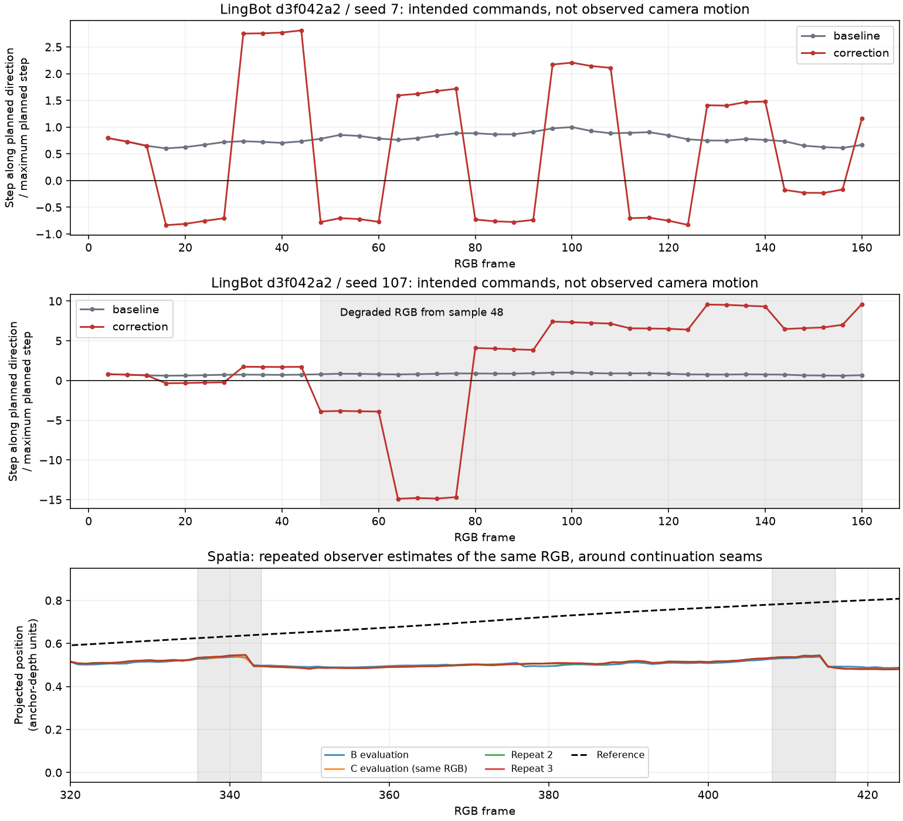

# Zigzag and collapse: commands, observations and visual continuity

Zigzag is not globally resolved. Its diagnosis must distinguish intended camera
inputs from estimated camera motion and visible scene failure. The new CPU audit
reconstructs all 16 historical LingBot pairs through RGB frame 160 using each
measured chunk anchor, and reproduces the Spatia repeated-observer boundary
measurements. No generator run or controller policy was changed.

[Audit script](artifacts/zigzag_reassessment_20261103/audit.py) ·
[Measurements and 47 input hashes](artifacts/zigzag_reassessment_20261103/audit.json).
The script runs in the original workspace with `baselines/venv_vmem/bin/python`.

The LingBot panels plot each intended translation projected onto that step's
planned direction, divided by the plan's maximum native step. Negative values
request a return along that direction. These are commands, not observed motion.
The Spatia panel plots estimated position along the reference trajectory's first
principal direction; the four curves evaluate the same generated RGB.

## Why LingBot can collapse while its observer keeps reporting poses

Historical rejoin eliminates residual within the next four native camera steps.
For uniform planned translation `v`, residual `e = M − P` and horizon `H`, the
translation step is `v − e/H`. It can become large, or reverse after overshoot.
LingBot then divides this step by the plan's maximum native translation step.
This is not a safety bound on corrected inputs.

For `d3f042a2/s107`, normalized step magnitudes reach 3.95 after boundary 44,
then 17.07 after boundary 60. The inspected samples show degradation at 48 and
noise collapse at 64. This chronology supports command magnitude as a contributor;
it does not isolate amplitude from rotation, history compatibility or observer
error. There is no established universal safe threshold at 4.

The historical `PoseWorker.measure` accepts an endpoint when the worker returns
success and the pose entries are finite. It does not require visual scene
preservation, feature consistency, or agreement of overlapping observed frames.
The caller applies rejoin after every accepted observation. A finite matrix
therefore does not mean the corrupted images still describe a coherent scene.

The archived logs verify **25 accepted correction observations after the first
visibly degraded samples** across these three runs:

| Case | First degraded sample | Later accepted feedback frames |
|---|---:|---|
| `d3f042a2/s107` | 48 | 60, 76, 92, 108, 124, 140, 156 |
| `74310829/s7` | 16 | 28, 44, 60, 76, 92, 108, 124, 140, 156 |
| `e43058cb/s7` | 24 | 28, 44, 60, 76, 92, 108, 124, 140, 156 |

Every listed observation is finite, has worker success and one valid pose, and
is followed by correction. The onsets are sampled visual findings, not exact
first-failure frames or a validated automatic detector. This establishes the
missing rejection behavior; it does not establish which subsequent estimated
pose is physically correct or that each update worsened the images.

The near-stationary measured-memory failure on `02267acf` is a separate protocol.
Its measured history enters the native encoder at about 70–106 times the planned
maximum step, while future camera tensors remain unchanged. Matched experiments
establish failure from the complete memory rewrite, not that translation amplitude
alone causes it. Independent normalization of history and future would change
their shared coordinate scale and is not a justified silent repair.

## Which runs actually reverse their intended commands?

The diagnostic counts adjacent intended world-frame translations with negative
dot product, with both magnitudes above 1% of the median planned step (minimum
1e−8). This threshold avoids counting effectively zero commands; it is not a
calibrated uncertainty or perceptual threshold. LingBot's first step in each
corrected chunk starts from its measured anchor, not the previous stored label.

All **16 LingBot correction runs have 2–10 direction reversals** through frame
160; all baseline and planned paths have zero under this definition. The full
per-case frames and angles are in the audit JSON. These are intended-command
reversals, not archived final-tensor verification or physical camera measurements.

The same-scene comparison prevents a misleading pass criterion:

| `d3f042a2` | Intended reversals | Maximum normalized step | Historical position result |
|---|---:|---:|---|
| Seed 7 | 10 | 2.85 | 86.8% lower mean error; recognizable sampled continuation |
| Seed 107 | 4 | 17.07 | 91.7% higher mean error; visual collapse |

Count alone does not rank tracking or visual quality. A return after overshoot
may be appropriate. Sustained oscillation, large corrections, unresolved lag and
scene damage must be reported together.

## Spatia: repeated backward estimated progress with zero command reversals

The 481-frame `0238de14/s7` A/B/C pilot has zero intended-command reversals in
every arm. B and C commands are exactly equal; the earlier RGB audit also
establishes identical generated videos. Four offline VIPE evaluations of that
same RGB give these eight-frame projected displacements:

| Interval | Range across four evaluations |
|---|---:|
| 264→272 | +0.0550 to +0.0704 |
| 336→344 | −0.0397 to −0.0313 |
| 408→416 | −0.0475 to −0.0353 |

The signed steps reproduce the saved repeated-observer receipt within 1e−10.
The backward effects occur consistently near continuation seams, so a one-off
numerical fluctuation is insufficient to explain them. Repeated use of one
observer can still share systematic error. Boundary RGB changes and baseline
image-flow reversals support a continuation issue, but do not distinguish camera
reversal from changing scene geometry. The detailed reversal count remains
observer-sensitive: identical B/C RGB previously produced different counts.

Thus command-direction constraints alone cannot resolve the Spatia symptom.
The next discriminating test must isolate native continuation/context and image
geometry, with the same reference and unchanged baseline controls.

## Corrections to earlier zigzag interpretations

DreamX's old 20–24 saved-label reversals were an anchor-accounting artifact.
The [native-anchor replay](legacy_rejoin_failures_20261103.md) finds zero intended
translation reversals in all ten audited historical runs. The old statement
that bounded control removed those command reversals is superseded. Large
recovery requests and tracking errors remain.

The separate bounded VMem pilot has 0, 1, 1 reconstructed increment reversals
in its three audited cases, rather than absolute-label counts of 9, 13, 15.
That is not a re-evaluation of every historical VMem context selection. The
[40-run VMem replay](vmem_legacy_failure_replay_20261103.md) explains the bridge,
window-normalization uncertainty and observer disagreement separately.

For SANA, a single-boundary return after overshoot cannot establish sustained
oscillation. For MatrixGame, the same-latent decoder diagnostic isolates an
image-seam contribution, not all physical camera motion. Neither should be
labelled zigzag-free from those narrower tests.

Keep legacy rejoin in the matched evaluation. Some scene failures do not disqualify
aggregate benefit; neither apparent pose improvement after collapse nor stalling
under a non-reversal constraint qualifies as successful control. Quality rejection
and longer recovery need separate, causally controlled validation before adoption.
